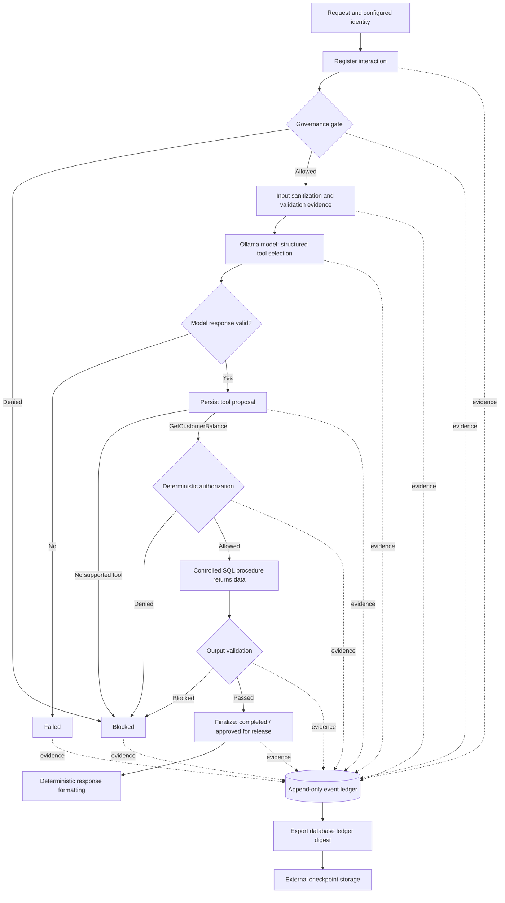
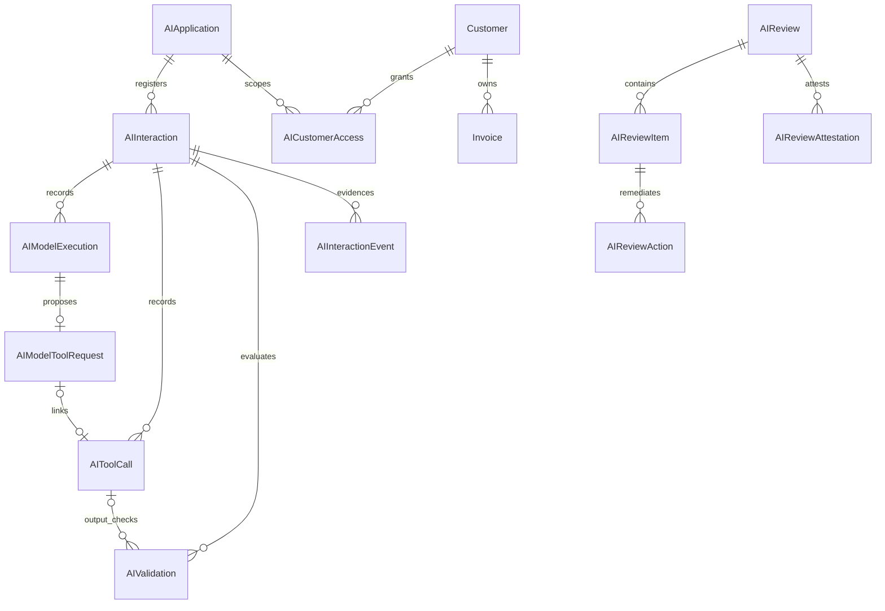
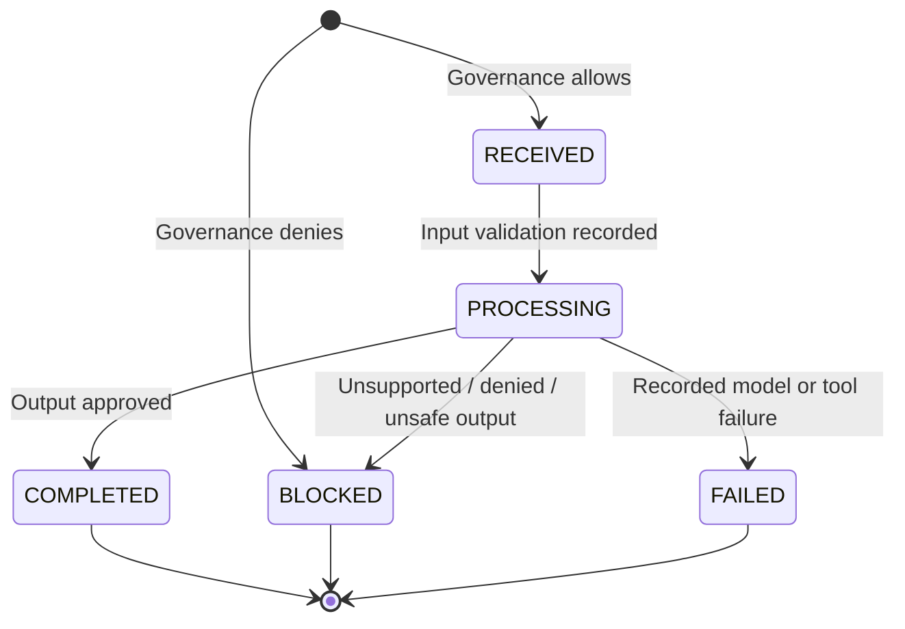

# AI Interaction Audit Framework (AIAF)
## Reference architecture

**Status:** Validated development proof of concept; implementation inventory refreshed 2026-11-18 | **Original reference implementation:** SQL Server 2022, Python, Ollama | **Current inspected deployment:** SQL Server 2025, `AIAF_EmptyTest` on `btg-kwilkie` | **Historical validation date:** 2026-11-15

> The AI provides intelligence. The architecture provides control.

## 1. Purpose and scope

AIAF demonstrates how an enterprise can constrain, observe and audit AI-mediated access to data. It is a provider-neutral architectural pattern with a concrete local implementation, not a production security product or compliance certification. The Acme Manufacturing accounts-receivable scenario uses synthetic customer and invoice data. The implemented workflow is read-only; approval-controlled financial writes are a design topic, not an implemented capability of this pipeline.

The central principle is that the model requests a capability; deterministic controls decide whether it may be exercised. An AI interaction is enterprise data in its own right, but recording that interaction must not create a second unrestricted copy of the business data.

## 2. Architectural principles

- Deny by default; enforce application governance before invoking the model.
- Separate application approval, requesting identity, tool selection, data authorization and response release.
- Expose narrowly scoped tools instead of arbitrary SQL or database credentials to the model.
- Validate untrusted inputs and outputs using deterministic rules.
- Record decisions, identifiers, rule versions and operating telemetry rather than raw sensitive payloads.
- Distinguish blocked requests, operational failures and successful release approval.
- Protect audit evidence with cryptographic checkpoints stored outside the database.
- Treat missing telemetry as unknown, never as zero.

## 3. Runtime architecture

The diagram depicts intended logical flow, not an exhaustive exception-handling state machine. Unexpected application or database failures can leave interactions in PROCESSING. Financial data is returned to the trusted Python process for validation and formatting; it is not sent back to the model. The model receives sanitized input and a synthetic customer directory for tool selection.

## 4. Components and responsibilities

| Component | Responsibility |
|---|---|
| `pipeline.py` | Orchestrate gates, evidence persistence, execution and release |
| `database.py` | SQL connection; development Windows authentication |
| `input_validation.py` | Pattern-based detection and sanitization of SSNs, card-like numbers and email addresses |
| `model_client.py` | Ollama structured tool selection, response contract validation and execution telemetry |
| `tool_dispatcher.py` | Persist proposals and dispatch allowlisted tools |
| `output_validation.py` | Validate tool result and persist rule outcomes |
| `interaction_lifecycle.py` | Request SQL-derived terminal decision |
| `response_formatter.py` | Render approved results or generic rejection messages without another model call |
| `fault_injection.py` | Development-only output corruption test harness |
| SQL Server | Governance, entitlement checks, controlled data access, lifecycle evidence and ledger |

### Data domains

| Schema / object | Purpose |
|---|---|
| `acme.Customer`, `acme.Invoice` | Synthetic operational data |
| `aiaf.AIApplication` | Registered application, owner, purpose, risk and enabled status |
| `aiaf.AICustomerAccess` | Application- and identity-specific customer entitlements, expiry and enabled status |
| `aiaf.AIInteraction` | Root interaction, correlation identifier, purpose and lifecycle |
| `aiaf.AIModelExecution` | Provider, model, prompt version, timing, usage, cost and execution outcome |
| `aiaf.AIModelToolRequest` | Structured proposal linked to a model execution |
| `aiaf.AIToolCall` | Authorization and execution outcome linked to the proposal |
| `aiaf.AIValidation` | Versioned input/output rule outcomes; output linked to tool call |
| `aiaf.AIInteractionEvent` | Append-only ledger evidence |
| `aiaf.AIAuditHeartbeat`, `aiaf.AIDriftRule` | Earlier-series monitoring and drift demonstration |
| `aiaf_governance.AIReview`, `AIReviewItem`, `AIReviewAction`, `AIReviewAttestation` | Periodic review, findings, remediation and attestation |
| `aiaf.vw_AIModelOperatingCost` | Aggregated live model telemetry by operating dimensions |

Logical relationship view; legacy interactions and tool calls can lack newer linkage fields. Governance associates reviews to applications by application code; do not infer a physical foreign key from that association.

## 5. Governance and authorization

The review workflow freezes an ordered evidence package, hashes it using SHA-256 and binds attestations to that hash. Review completion is not equivalent to approval. The runtime gate evaluates application registration, enabled state, latest completed attestation and evidence hash consistency. Only APPROVED is admitted; SUSPENDED, REJECTED, RESTRICTED, CONDITIONALLY_APPROVED, missing or invalid attestations fail closed in this implementation.

`aiaf.usp_BeginInteraction` registers the interaction and records governance evidence. `aiaf_tool.GetCustomerBalance` reevaluates governance and checks current customer entitlement, including active customer, enabled grant, read permission and expiry. The procedure consumes the persisted proposal identifier, not a new customer argument supplied at dispatch time. A denied or nonexistent customer produces a generic access denial rather than a balance or existence disclosure.

The runtime database role is restricted to approved procedure execution and denied direct access to protected schemas. Governance roles separate review freezing and attestation. Development tests use database impersonation; authentication of application and end-user identity is not implemented. SQL ownership chaining supports controlled access without granting direct table reads.

## 6. Validation and model contract

Input rules version 1 detect SSN, payment-card-like and email patterns. Matches are replaced in memory; only findings are persisted. This is limited regex-based sanitization, not comprehensive DLP. The model must return exactly `ToolCode` and `CustomerCode`, with either `GetCustomerBalance` and a valid customer code or `NO_SUPPORTED_TOOL` and an empty code. Invalid model output is rejected. A valid proposal conveys no authorization.

Output validation evaluates five rules: `OUTPUT_AUTHORIZATION`, `OUTPUT_ROW_COUNT`, `OUTPUT_SCHEMA`, `OUTPUT_FINANCIAL_INTEGRITY`, `OUTPUT_CUSTOMER_BINDING`. These verify successful authorized execution and linkage, one result row, exact expected columns, numeric/count consistency and binding to the proposed customer. Expected fields are CustomerCode, CustomerName, OutstandingBalance, DisputedBalance, OpenInvoiceCount and DisputedInvoiceCount. These checks do not independently establish financial accuracy or eliminate every disclosure channel.

The SQL validation procedures enforce rule-set and metadata consistency but trust the runtime's reported observations. Only a persisted passing output assessment and SQL-derived completion decision permit normal release. The formatter uses USD presentation as a lab convention.

## 7. Lifecycle and evidence

LEGACY and AWAITING_APPROVAL also exist in the schema but are not active states in this read-only path. `aiaf.usp_CompleteInteraction` derives outcomes from persisted evidence rather than accepting a caller-supplied success flag. COMPLETED means authorized for release, not confirmed delivery. An interruption before finalization may leave an orphaned nonterminal interaction. The implementation does not guarantee exactly-once delivery.

Evidence chain: interaction → model execution → proposal → tool call → output validation → finalization. Correlation and relational identifiers allow reconstruction of decisions. Principal identity, application/workflow, customer code, timing and authorization details remain sensitive metadata. Neither raw/sanitized prompt text nor financial result values are persisted by the normal audit path. Diagnostic and infrastructure logging must also be controlled.

## 8. Operating telemetry

Capture provider/model, prompt version, timestamps, client and server timings, load duration, token counts, execution status, error code, environment and telemetry source. Cost fields support reported or estimated cost with basis and reference; local Ollama usage does not supply billing costs, so cost is NULL. LIVE denotes live provider invocation or attempt, not production traffic. SYNTHETIC and REPLAY distinguish other observations. The operating-cost view filters LIVE but does not by itself exclude deliberate faults or identify every test scenario. Coverage and cost basis must accompany monetary totals; unknown cost is not free usage.

## 9. Cryptographic audit evidence

`aiaf.AIInteractionEvent` is an append-only ledger table. SQL Server computes transaction and block hashes. Export `sys.sp_generate_database_ledger_digest` output to external storage and verify against the previously captured checkpoint using `sys.sp_verify_database_ledger @digests` (JSON array). A new digest generated immediately before verification is not a substitute for a trusted historical anchor.

The lab verified block 0 and showed that a deliberately altered supplied hash is rejected (errors 37368 and 37392). This is a digest mismatch test, not an actual database tampering experiment. Only ledger-protected events receive this protection; ordinary framework tables do not. Ledger integrity does not prove event truth, completeness or confidentiality. External local file storage is not an independently protected immutable trust boundary.

## 10. Historical demonstrated results (2026-11-15)

Final inventory from the development database on 2026-11-15 (includes earlier-series fixtures and intermediate tests):

| Metric | Count |
|---|---:|
| Interactions | 1,105 |
| Applications | 2 |
| Model executions | 28 |
| Model tool requests | 20 |
| Tool calls | 1,269 |
| Validations | 133 |
| Output validations (subset) | 55 |
| Finalization events | 15 |
| Ledger events | 201 |
| Ledger transactions | 168 |
| Ledger blocks | 1 |

Final end-to-end scenarios:

| Interaction | Scenario | Observed outcome |
|---:|---|---|
| 1097 | Authorized Northwind request | COMPLETED |
| 1098 | Unauthorized Fabrikam request | BLOCKED |
| 1099 | Sensitive SSN input; authorized request | COMPLETED after sanitization |
| 1100 | Prompt injection / unsupported tool | BLOCKED |
| 1101 | Unexpected output column | BLOCKED |
| 1102 | Incorrect customer binding | BLOCKED |
| 1103 | Invalid financial balance | BLOCKED |
| 1104 | Model unavailable | FAILED; MODEL_CONNECTION_ERROR |
| 1105 | Suspended application | BLOCKED before model invocation |

Nine scenarios matched expected outcomes; no unauthorized financial response was observed in these tests. This is not a statistical security guarantee. Earlier manual validation (1085), retrospective finalization (1089–1095), deliberate faults (1093–1095, 1101–1103), and abandoned interaction 1096 must be distinguished from normal operations. Historical fixtures should not be used as production performance or security metrics.

## 11. Current deployed implementation reference (2026-11-18)

This section supplements the original architecture and its **2026-11-15 historical proof-of-concept results**. The new inventory comes from deployed SQL Server metadata, SSMS-generated procedure definitions, and uploaded Python and integration-test sources. **Source inspection is not equivalent to executing the full test suite.** The SQL Server 2022 reference in the original lab and the SQL Server 2025 inspected deployment are different snapshots, not interchangeable validation environments.

### 11.1 Deployed database inventory

**16 tables** across three schemas (an earlier conversational count of 17 was incorrect):

| Schema | Tables |
|---|---|
| `acme` (2) | `Customer`, `Invoice` |
| `aiaf` (10) | `AIApplication`, `AIAuditHeartbeat`, `AICustomerAccess`, `AIDriftRule`, `AIInteraction`, `AIInteractionEvent`, `AIModelExecution`, `AIModelToolRequest`, `AIToolCall`, `AIValidation` |
| `aiaf_governance` (4) | `AIReview`, `AIReviewAction`, `AIReviewAttestation`, `AIReviewItem` |

The metadata inventory contains **14 declared foreign keys**, all reported enabled and trusted. These link customer/invoice/access; application/interaction; interaction/model execution/tool proposal/tool call/validation/event; and governance review/items/actions/attestations. Reviews associate with applications by application code rather than a declared review-to-application foreign key. The inventory recorded **164 column definitions**.

`AIInteraction` has exactly these ten columns: `InteractionId`, `RequestingIdentity`, `WorkflowCode`, `InteractionAt`, `ExperimentPeriod`, `ApplicationId`, `CorrelationId`, `BusinessPurpose`, `InteractionStatus`, `CompletedAt`. It does **not** have `ResponseDeliveryConfirmed` or `FinalDecisionCode` columns. `ResponseDeliveryConfirmed = false` is written in the **JSON event details** for `INTERACTION_FINALIZED`; this is not proof of actual response delivery.

### 11.2 Deployed stored procedure contracts

| Procedure | Parameters | Purpose |
|---|---:|---|
| `aiaf.usp_BeginInteraction` | 8 | Validate context, evaluate governance, register interaction and events |
| `aiaf.usp_CompleteInteraction` | 1 | Derive final state from persisted evidence and record finalization |
| `aiaf.usp_EvaluateGovernanceGate` | 7 | Check registered/enabled application, latest completed review attestation and evidence hash |
| `aiaf.usp_RecordInputValidation` | 2 | Require three input-rule findings; transition `RECEIVED` to `PROCESSING` |
| `aiaf.usp_RecordModelExecution` | 27 | Persist model execution, usage/cost telemetry and event |
| `aiaf.usp_RecordModelToolRequest` | 4 | Persist validated model proposal and controlled arguments |
| `aiaf.usp_RecordOutputValidation` | 3 | Require five output-rule findings and eligible tool execution |
| `aiaf_governance.usp_AttestReview` | 6 | Validate frozen evidence/hash and attestation restrictions |
| `aiaf_governance.usp_FreezeReview` | 1 | Freeze ordered review evidence package and compute SHA-256 hash |
| `aiaf_tool.GetCustomerBalance` | 2 | Recheck governance, authorize customer read and record tool execution |

**Total: 10 procedures and 61 parameters.** The generated SQL definitions, not `sys.parameters`, establish parameter defaults. `usp_RecordModelExecution` has optional telemetry fields, with `@CostBasis = 'UNAVAILABLE'` by default.

The deployed workflow currently expects **exactly one live `TOOL_SELECTION` model execution** at completion. Model proposals are limited to `GetCustomerBalance` (customer code matching `CUST-` plus four digits) and `NO_SUPPORTED_TOOL`. A proposal does not authorize execution. `GetCustomerBalance` consumes the persisted proposal identifier and reevaluates the governance gate and customer entitlement before accessing financial data. `usp_CompleteInteraction` derives `COMPLETED`, `BLOCKED`, or `FAILED` from recorded evidence, and approves release only when all five output rules pass and the recorded tool returned one row.

Input findings must cover version-1 `US_SSN_PATTERN`, `PAYMENT_CARD_PATTERN`, and `EMAIL_ADDRESS_PATTERN`. Output findings must cover version-1 `OUTPUT_AUTHORIZATION`, `OUTPUT_ROW_COUNT`, `OUTPUT_SCHEMA`, `OUTPUT_FINANCIAL_INTEGRITY`, and `OUTPUT_CUSTOMER_BINDING`. SQL validates the shape and consistency of reported findings; it does not independently reproduce every Python-side content check. The procedures use individual SQL transactions; the entire Python pipeline is **not** one atomic database transaction.

### 11.3 Explicit runtime permissions

The `AIAF_Runtime` database role has object-level `EXECUTE` grants on:

- `aiaf.usp_BeginInteraction`, `aiaf.usp_CompleteInteraction`, `aiaf.usp_RecordInputValidation`, `aiaf.usp_RecordModelExecution`, `aiaf.usp_RecordModelToolRequest`, `aiaf.usp_RecordOutputValidation`.
- `aiaf_tool.GetCustomerBalance`.

The role has schema-level `DENY` for `SELECT`, `INSERT`, `UPDATE`, and `DELETE` on `acme`, `aiaf`, and `aiaf_governance`; `EXECUTE` is additionally denied on `aiaf_governance`. `aiaf.usp_EvaluateGovernanceGate` is invoked internally rather than directly granted to the runtime role. This is an **explicit-permissions inventory**, not a complete proof of effective permissions, impersonation behavior, or ownership chaining. Runtime identity authentication remains a separate production concern.

### 11.4 Python-to-SQL execution mapping

| Python module | SQL entry point or responsibility |
|---|---|
| `pipeline.py` | Orchestrates `process_request`, evidence reconciliation and rejection handling |
| `database.py` | Builds SQL connection and connects to the configured database |
| `input_validation.py` | Sanitizes request and calls `aiaf.usp_RecordInputValidation` |
| `model_client.py` | Calls Ollama for constrained JSON tool selection and captures telemetry |
| `tool_dispatcher.py` | Calls `aiaf.usp_RecordModelToolRequest` and `aiaf_tool.GetCustomerBalance` |
| `output_validation.py` | Evaluates five output rules and calls `aiaf.usp_RecordOutputValidation` |
| `interaction_lifecycle.py` | Calls `aiaf.usp_CompleteInteraction` |
| `response_formatter.py` | Deterministically formats approved results or safe rejection messages |

The inspected model client uses Ollama `qwen3:8b`, prompt version 2, and a synthetic customer directory supplied by configuration. The model selects a supported tool proposal; it never receives raw financial tool results for response generation. Unexpected application errors are converted to generic rejections for the caller; this alone does not guarantee a finalized SQL interaction.

## 12. Current testing status, differences and next verification

### 12.1 Separate the two evidence snapshots

| Evidence | Environment / date | Supported conclusion |
|---|---|---|
| Historical nine end-to-end scenarios (Section 10) | Original development lab, 2026-11-15 | Nine reported scenarios matched expected outcomes **in that earlier environment** |
| New `AUTHORIZED_CUSTOMER` live integration run | `AIAF_EmptyTest`, 2026-11-18 | One authorized customer request passed with persisted model, tool and validation evidence |
| Uploaded Python unit/integration sources | Source review, 2026-11-18 | Test cases exist; no full-suite pass is established by source inspection |

The newer authorized scenario used run ID `91aee6c8-3595-4128-9653-d1fd8851e0d3`, `InteractionId = 4`, `ModelExecutionId = 3`, `ModelToolRequestId = 2`, and `AIToolCallId = 2`. The live Ollama tool selection succeeded; the SQL tool returned the expected synthetic balance; eight validation records passed (three input, five output). These IDs and outcomes belong to the new test database and must **not** be mixed with historical interaction IDs 1097–1105.

### 12.2 Test suite and known gaps

The uploaded integration runner defines **ten scenarios**: `AUTHORIZED_CUSTOMER`, `UNRECOGNIZED_IDENTITY`, `UNAUTHORIZED_CUSTOMER`, `SENSITIVE_INPUT`, `UNSUPPORTED_REQUEST`, `UNEXPECTED_COLUMN`, `INCORRECT_CUSTOMER`, `INVALID_FINANCIAL_BALANCE`, `MODEL_UNAVAILABLE`, and `GOVERNANCE_SUSPENSION`. Only the first has been verified in the current fresh-database testing described here. Some remaining scenarios still reference older `ACME_CUSTOMER_SERVICE_AI`, `CUST-1001`, or `CUST-1003` fixtures; reconcile their expected semantics and the SQL verifier before running the suite.

**Open verification and hardening items:**

1. Compare the deployed SQL definitions with version-controlled database scripts; repository/deployment parity is not yet established.
2. Verify effective runtime permissions and denied direct access with impersonation tests, in addition to the explicit permission inventory.
3. Align integration fixtures, then run and inspect the full ten-scenario suite; do not infer a pass from the historical lab.
4. Define recovery for abandoned/stuck `RECEIVED` or `PROCESSING` interactions as a production-hardening item, without changing the schema prematurely.
5. Decide whether and how to track actual response delivery separately from SQL approval for release.
6. Preserve the production-readiness caveats: application identity authentication, comprehensive DLP, independent digest anchoring, privacy controls, and broader negative-path coverage remain outside the verified proof of concept.

## 13. Related documentation

See [Production readiness considerations](PRODUCTION_READINESS.md) for deployment gaps and acceptance criteria. This document combines the historical observed lab and established design with a 2026-11-18 deployed SQL and uploaded Python source review. It is not a full repository-to-deployment parity audit or production certification.

> Trust nothing. Test everything. Keep the receipts.
