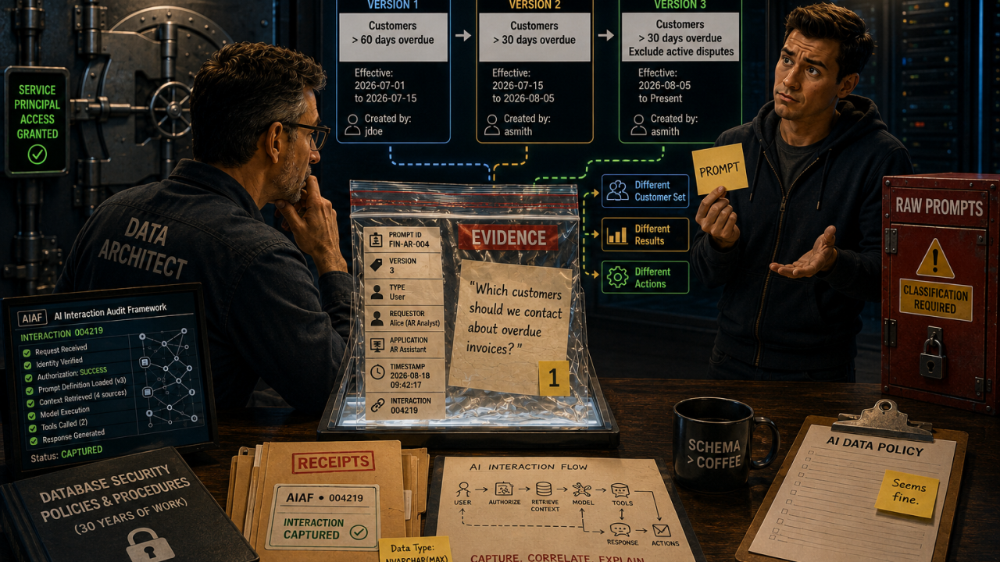

# AI Has Your Data. Now What? #2

**Author:** Kevin Wilkie, MBA
**Published:** August 27, 2026
**Original publication:** [LinkedIn article](https://www.linkedin.com/pulse/ai-has-your-data-now-what-2-kevin-wilkie-mba-d4cle/)



> **Archive note:** This article preserves the original published narrative and SQL examples as an educational snapshot. The SQL below is **not** the supported deployment procedure. The current AIAF implementation and installation process have evolved; see [Getting Started](../GETTING_STARTED.md) and [Production Readiness](../PRODUCTION_READINESS.md).

# Your Prompt Is Data

In the first article in this series, I made the argument that once AI touches enterprise data, the interaction itself becomes enterprise data.

Now we need to start keeping the receipts.

And the obvious place to begin is the prompt.

Except there's a problem.

What exactly is a prompt?

That sounds like a ridiculous question.

Someone types:

> Show me our top ten customers by revenue.

That's the prompt, right?

Maybe.

What if the application quietly adds:

> You are a financial analyst for Sherpa of Data. Only answer questions using information supplied by approved company systems.

Now we have a system prompt.

What if the user's question gets inserted into a reusable template?

What if we retrieve customer data and add that to the context?

What if an agent adds instructions describing which tools it can use?

What if our application modifies any of those instructions next Tuesday?

Suddenly:

`Prompt = VARCHAR(MAX)`

isn't looking like much of a data model.

## The Prompt That Produced the Answer

Suppose someone asks our AI:

> Which customers should we contact about overdue invoices?

The AI produces a list.

Someone acts on it.

Three months later, a customer complains.

Now I'd like to know something.

What instructions produced that list?

Not what instructions the application uses today.

What instructions did it use then?

Maybe the original system prompt said:

> Identify customers with invoices more than 60 days overdue.

But two weeks later someone changed it to:

> Identify customers with invoices more than 30 days overdue.

Then somebody made another perfectly reasonable change:

> Exclude customers with an active billing dispute.

Those are three different business rules.

If all we stored was:

> Which customers should we contact about overdue invoices?

we haven't preserved enough information to explain the result.

The user's words didn't change.

The meaning of the interaction did.

## Prompts Have Versions

Data people should recognize this problem immediately.

We wouldn't normally overwrite yesterday's business rule and then pretend it had always worked that way.

At least, we shouldn't.

Yet AI applications frequently have instructions buried in:

- Python code
- Configuration files
- Environment variables
- Agent definitions
- Application settings
- Prompt-management tools
- Someone's surprisingly important text file

And when those instructions change, the behavior of the application can change with them.

So we're going to treat prompts like something we already understand:

versioned enterprise artifacts.

A prompt template needs an identity.

It needs a version.

It needs an effective date.

We need to know whether it was active.

We need to know what changed.

And when an interaction occurs, we need to know which version was actually used.

Not which version happens to be sitting in Git today.

## The User Is Part of the Data Too

Now suppose two people ask exactly the same question:

> Show me our largest overdue customers.

One works in Accounts Receivable.

The other works in the warehouse.

Same prompt.

Very different security context.

Seems that capturing the text isn't enough.

An AI interaction needs identity.

Who made the request?

Was it a person?

An application?

A service principal?

Another agent?

Which application originated the request?

Which session?

Which security context?

This becomes even more important once agents start talking to other agents.

Eventually, we may have:

`Person → Agent → Agent → Tool → Database`

If something goes wrong at the database, "the AI did it" isn't going to be a particularly satisfying audit record.

We need correlation.

## Give the Interaction an Identity

This is where our AI Interaction Audit Framework — AIAF starts becoming real.

Every AI interaction gets an identifier.

Something simple like `InteractionId`

That identifier follows the request throughout its journey.

The user request.

Validation.

Authorization.

Retrieved context.

Model execution.

Tool calls.

Database access.

Response.

Actions.

Errors.

Human approvals.

Eventually, when we're investigating something six months later, that identifier lets us reconstruct the interaction.

Think of it like a correlation ID for an AI data pipeline.

Because that's exactly what it is.

## Let's Have Fun and Actually Build Something

For this series, I'm building AIAF in SQL Server 2025.

SQL Server isn't a requirement for the architecture.

It's simply our reference implementation.

The same patterns could be implemented in Snowflake, PostgreSQL, another relational platform, or whatever makes sense in your environment.

We're also going to use Python for our reference application and Ollama for our local models.

Again, intentionally.

I don't want the security architecture we're designing to depend on a particular cloud provider or model vendor.

Bring your own model.

The controls we're building should survive the swap.

## Our First AIAF Tables

I'm intentionally not going to design all fifteen articles' worth of database tables today.

That would be cheating.

Right now, we know enough to capture two important concepts:

the interaction

and

the prompt definition that helped create it.

Let's start there.

```sql
CREATE SCHEMA aiaf AUTHORIZATION dbo;
GO

CREATE TABLE aiaf.PromptDefinition
(
    PromptDefinitionId   bigint IDENTITY(1,1) NOT NULL,
    PromptName           nvarchar(200) NOT NULL,
    PromptType           varchar(30) NOT NULL,
    PromptVersion        int NOT NULL,
    PromptText           nvarchar(max) NOT NULL,
    EffectiveFrom        datetime2(3) NOT NULL,
    EffectiveTo          datetime2(3) NULL,
    IsActive             bit NOT NULL,
    CreatedAt            datetime2(3) NOT NULL,
    CreatedBy            nvarchar(200) NOT NULL,

    CONSTRAINT PK_PromptDefinition
        PRIMARY KEY (PromptDefinitionId),

    CONSTRAINT UQ_PromptDefinition_NameVersion
        UNIQUE (PromptName, PromptVersion)
);
GO
```

Already we're doing something useful.

We're not simply storing "the prompt."

We're saying:

Which prompt?

What kind?

Which version?

When was it valid?

Who created it?

Then we need the interaction itself.

```sql
CREATE TABLE aiaf.AIInteraction
(
    InteractionId        uniqueidentifier NOT NULL,
    ParentInteractionId  uniqueidentifier NULL,

    RequestedAt          datetime2(3) NOT NULL,
    CompletedAt          datetime2(3) NULL,

    RequestorType        varchar(30) NOT NULL,
    RequestorId          nvarchar(200) NOT NULL,
    ApplicationName      nvarchar(200) NOT NULL,

    PromptDefinitionId   bigint NULL,

    Status               varchar(30) NOT NULL,

    CONSTRAINT PK_AIInteraction
        PRIMARY KEY (InteractionId),

    CONSTRAINT FK_AIInteraction_Parent
        FOREIGN KEY (ParentInteractionId)
        REFERENCES aiaf.AIInteraction (InteractionId),

    CONSTRAINT FK_AIInteraction_PromptDefinition
        FOREIGN KEY (PromptDefinitionId)
        REFERENCES aiaf.PromptDefinition (PromptDefinitionId)
);
GO
```

This isn't our finished framework.

Not even close.

In fact, there's something rather conspicuous missing.

The user's actual prompt.

That's intentional.

## Wait. We Aren't Saving the Prompt?

We just spent an entire article saying prompts are data.

Surely, we should add:

`UserPrompt nvarchar(max)`

and be done with it.

Not so fast.

What happens when someone types:

> Customer John Smith's SSN is 123-45-6789. Tell me whether he can afford...

Where should that raw prompt live?

Who should be allowed to see it?

How long should we retain it?

Should our operations team see it?

Should analysts studying AI performance see it?

What happens when the prompt is rejected specifically because it contains restricted information?

Should we permanently store the exact information we just prevented from reaching the model?

These aren't theoretical questions.

And blindly putting `UserPrompt nvarchar(max)` onto our interaction table answers all of them accidentally.

The answer becomes:

Everybody who can read the audit table gets everything, for however long we keep the table.

No thanks.

So we're going to stop here.

Our interaction exists.

Our prompt definitions are versioned.

Our identities are captured.

Our correlation structure exists.

But before we store raw user input, we need to decide what we're actually allowed to retain.

## The First Receipt

We haven't captured everything yet.

That's okay.

Good audit architecture doesn't mean collecting every byte you can find.

It means deliberately collecting the evidence you need while understanding the security implications of keeping it.

Today, our receipt tells us:

An interaction occurred.

When it occurred.

Who initiated it.

Which application initiated it.

Whether it was part of another interaction.

Which versioned prompt definition participated.

What happened to the interaction.

That's already considerably better than:

Somebody asked the AI something Tuesday.

But we're nowhere near finished.

Because the most obvious thing to record may also be one of the most dangerous things to keep.

In the next article, we're finally going to save the user's prompt.

Carefully.

Because there's nothing quite like building a security system that catches sensitive data...

and then helpfully stores a permanent copy of it.
