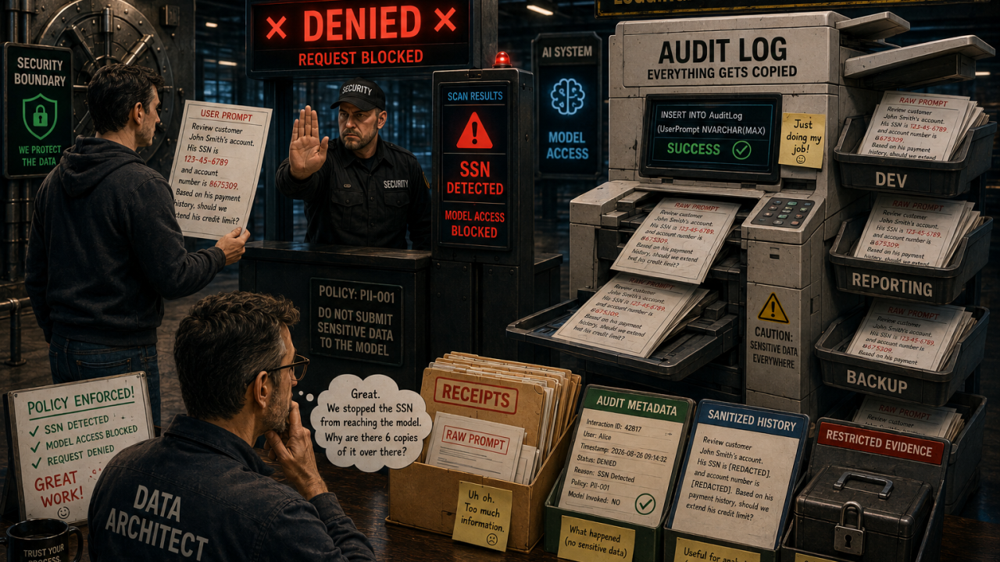

# AI Has Your Data. Now What? #3

**Congratulations, You Just Logged the SSN**
**Author:** Kevin Wilkie, MBA
**Published:** September 3, 2026
**Original:** [LinkedIn article](https://www.linkedin.com/pulse/ai-has-your-data-now-what-3-kevin-wilkie-mba-3x7qe/)



> **Historical article:** This is an archival Markdown edition of the published article. Its SQL examples document the framework's development at the time and are not the current deployment instructions. See [Getting Started](../GETTING_STARTED.md) and [Testing](../TESTING.md) for the supported implementation.

In the last article, we started building the AI Interaction Audit Framework — AIAF.

We created an interaction.

We captured identity.

We versioned our prompt definitions.

We gave every interaction a correlation ID so we could eventually reconstruct what happened.

And then we deliberately left out something rather important.

The user's actual prompt.

That probably seemed strange for something called an AI Interaction Audit Framework.

There was a reason.

Because today we're going to save it.

And immediately discover why that can be a terrible idea.

## Our Security Control Worked!
Imagine one of our users submits this prompt:

Review customer John Smith's account. His SSN is 123-45-6789 and account number is 8675309. Based on his payment history, should we extend his credit limit?
Our organization has a policy prohibiting Social Security numbers from being submitted to the model.

Good policy.

Better yet, we've built a validation layer that runs before the request reaches the model.

It detects the SSN.

The interaction is denied.

The model never sees the prompt.

Our security control worked perfectly! Yay us!

Then our application does this:

```python
log_interaction(
    interaction_id=interaction_id,
    user_prompt=user_prompt,
    status="DENIED",
    reason="Sensitive data detected"
)
```
And our database now contains:

Review customer John Smith's account.
His SSN is 123-45-6789 and account number is 8675309...
Well done, everybody.

We successfully prevented sensitive information from reaching the AI.

Then built another database containing it.

## Logging Is Data Movement
This is the part that's easy to miss.

We tend to think of logging as observation.

Something happened.

We wrote down what happened.

But if the thing we're logging contains sensitive data, logging is also data movement.

We took information from one security context and copied it straight into another.

That raises exactly the kinds of questions data professionals have been dealing with forever.

Who can access the copy?

Is it encrypted?

Is it backed up?

Where do those backups go?

Does it get replicated?

Does it appear in a reporting environment?

Can developers query it?

Can support personnel query it?

Does it end up in DEV or TEST during a database refresh?

How long do we retain it?

Can someone request its deletion?

Is it subject to legal hold?

Congratulations.

Our AI audit database just became another sensitive enterprise data store.

And unlike the original customer system, there's a decent chance nobody designed it that way.

## "Log Everything" Is Not an Audit Strategy
There's a very tempting answer to AI auditing:

Save every prompt and every response.
Then we'll always know what happened.

Technically, that's true.

We could also install cameras in every conference room and record every conversation forever.

We'd certainly have excellent records.

We'd also have many other problems.

The goal isn't to Collect everything.

The goal is to Collect enough evidence to reconstruct what happened without unnecessarily increasing the organization's risk.

Those are very different architectures.

So AIAF needs to separate several concepts that are often shoved into one giant logging table.

## Not All Receipts Belong in the Same Drawer
For our reference architecture, we're going to divide interaction evidence into three broad categories.

### Audit Metadata
This tells us what happened without necessarily containing the sensitive content itself.

For example:

```text
InteractionId:       7E41...
Requestor:           Alice
Timestamp:           2026-08-26 09:14:32
Application:         AR Assistant
PromptVersion:       3
ValidationResult:    DENIED
PolicyId:            PII-001
DetectionType:       SSN
ModelInvoked:        NO
```
That is incredibly useful information.

And notice what isn't there.

The SSN.

### Sanitized Interaction History
Sometimes we need more than metadata.

We may want to analyze what users are asking.

We may want to investigate model behavior.

Later in this series, we'll use historical interactions to measure drift.

For those purposes, we might retain something like:

Review customer account [CUSTOMERACCOUNT] SSN [REDACTED]. Based on payment history, should we extend the credit limit?
Now we preserve the nature of the interaction without unnecessarily preserving every sensitive value contained within it.

This isn't perfect anonymization.

It isn't supposed to be.

It's a deliberately different data product with a deliberately different security purpose.

### Restricted Raw Evidence
And sometimes we really may need the original.

Perhaps regulatory requirements demand it.

Perhaps an investigation requires exact reconstruction.

Perhaps the interaction resulted in a significant business action and organizational policy requires preservation of the original evidence.

But then let's call it what it is.

Restricted evidence.

Not:

UserPrompt nvarchar(max)
sitting beside Status where every developer troubleshooting the application can casually SELECT it.

Raw evidence should have its own security boundary.

Its own permissions.

Its own retention policy.

Potentially its own encryption strategy.

Potentially its own storage platform.

And perhaps it shouldn't exist at all for some interactions.

## Classify Before You Persist
That gives us an important change to our AI pipeline.

Previously, we described it roughly like this:

Request → Validate → Authorize → Execute → Observe → Persist

That's not quite enough.

Because if persistence happens before we understand the content, we've already lost control of where sensitive information is going.

We need something closer to:

Request → Classify → Sanitize → Validate → Authorize → Execute → Persist Appropriate Evidence

Notice where classification happens.

Before persistence.

That's deliberate.

We want the architecture to decide what we're permitted to retain before the logging framework helpfully retains everything.

## But Don't We Need the Raw Prompt to Classify It?
That would make sense, right?

Welcome to security architecture.

For some period of time, the application obviously has the raw input in memory.

Otherwise, we couldn't inspect it.

The distinction is between processing sensitive information and persisting another copy of it.

Our validation component can inspect the raw request, identify sensitive information, generate the appropriate metadata and sanitized representation, and then discard the raw content unless policy specifically requires us to retain it.

Conceptually:

```text
 ┌── Audit Metadata
                     │
Raw Request
     ↓               ├── Sanitized History
Classification ──────┤
     ↓               │
Policy Decision      └── Restricted Raw Evidence
                              ↑
                         only if required
```

That very bottom line matters.

Raw evidence isn't our default destination.

It's an explicit policy decision.

## Building AIAF: Classification
Let's add classifications to our framework.

```sql
CREATE TABLE aiaf.DataClassification
(
    DataClassificationId  int IDENTITY(1,1) NOT NULL,
    ClassificationName    varchar(50) NOT NULL,
    ClassificationLevel   tinyint NOT NULL,
    Description           nvarchar(500) NULL,
    RawRetentionAllowed   bit NOT NULL,
    DefaultRetentionDays  int NULL,
    CreatedAt             datetime2(7) NOT NULL
        CONSTRAINT DF_DataClassification_CreatedAt
        DEFAULT SYSUTCDATETIME(),

    CONSTRAINT PK_DataClassification
        PRIMARY KEY (DataClassificationId),

    CONSTRAINT UQ_DataClassification_Name
        UNIQUE (ClassificationName)
);
GO
```
For the Sherpa of Data dataset, we might start with:

```sql
INSERT INTO aiaf.DataClassification
(
    ClassificationName,
    ClassificationLevel,
    Description,
    RawRetentionAllowed,
    DefaultRetentionDays
)
VALUES
('Public',       1, 'Approved for public disclosure',           1, 365),
('Internal',     2, 'Internal business information',            1, 180),
('Confidential', 3, 'Sensitive business or customer data',      1,  90),
('Restricted',   4, 'Highly sensitive or regulated information',0, NULL);
GO
```
Already, we're making retention a deliberate decision rather than an accidental side effect of logging.

## Record What We Found
Next, we need to record classification results against an interaction.

```sql
CREATE TABLE aiaf.InteractionClassification
(
    InteractionClassificationId bigint IDENTITY(1,1) NOT NULL,
    InteractionId               bigint NOT NULL,
    DataClassificationId        int NOT NULL,
    DetectionType               varchar(100) NOT NULL,
    DetectionMethod             varchar(50) NOT NULL,
    DetectionCount              int NOT NULL,
    DetectedAt                  datetime2(3) NOT NULL
        CONSTRAINT DF_InteractionClassification_DetectedAt
        DEFAULT SYSUTCDATETIME(),

    CONSTRAINT PK_InteractionClassification
        PRIMARY KEY (InteractionClassificationId),

    CONSTRAINT FK_InteractionClassification_Interaction
        FOREIGN KEY (InteractionId)
        REFERENCES aiaf.AIInteraction (InteractionId),

    CONSTRAINT FK_InteractionClassification_Classification
        FOREIGN KEY (DataClassificationId)
        REFERENCES aiaf.DataClassification (DataClassificationId)
);
GO
```
Now our audit record can tell us: Restricted information was detected.

It can tell us: An SSN pattern was detected once.

It can tell us: The interaction was denied.

Without needing to tell every person with audit access:

And by the way, here's the SSN.
That's actual progress.

## The Sanitized Copy
We still want something we can use for operational analysis and eventually drift detection.

So, let's create somewhere for sanitized content.

```sql
CREATE TABLE aiaf.SanitizedInteractionContent
(
    InteractionId        bigint IDENTITY(1, 1) NOT NULL,
    ContentType          varchar(30) NOT NULL,
    SanitizedContent     nvarchar(max) NOT NULL,
    SanitizationMethod   varchar(100) NOT NULL,
    SanitizedAt          datetime2(3) NOT NULL
        CONSTRAINT DF_SanitizedInteractionContent_SanitizedAt
        DEFAULT SYSUTCDATETIME(),

    CONSTRAINT PK_SanitizedInteractionContent
        PRIMARY KEY (InteractionId, ContentType),

    CONSTRAINT FK_SanitizedInteractionContent_Interaction
        FOREIGN KEY (InteractionId)
        REFERENCES aiaf.AIInteraction (InteractionId)
);
GO
```
Notice that we're calling it SanitizedInteractionContent.

Not PromptLog.

Later, responses will need the same treatment.

Retrieved context may need it.

Tool parameters may need it.

Agent actions may contain sensitive information too.

The problem doesn't end with the prompt.

We're designing something we can extend.

## Where's the Raw Evidence Table?
I'm not creating it yet.

That's intentional.

Because before we build a place to store restricted raw evidence, we need to answer harder questions:

Who gets access?

How do we encrypt it?

How do we prevent privileged users from casually reading it?

How do we enforce retention?

Should it even live in the same database?

How do we prove nobody altered it?

Those decisions deserve more thought than:

```sql
CREATE TABLE aiaf.RawPrompt
(
    Prompt nvarchar(max)
);
```
We'll get there.

But we're not creating the dangerous table first and figuring out how to secure it later.

We've all seen how that movie ends.

## One More Problem
There's another interesting question hiding inside our classification layer.

How did we decide that the prompt contained an SSN?

We could ask an AI: Does this prompt contain sensitive information?

And it might do a pretty good job.

But...

Do we really need an AI to recognize:

123-45-6789

as something that looks like a Social Security number?

More importantly, if organizational policy says:

Social Security numbers must never be submitted to an AI model
should our first security control be:

Submit it to an AI model and ask whether it's a Social Security number?
That seems...

suboptimal.

Some security decisions are probabilistic.

Some shouldn't be.

In the next article, we'll start separating the controls that should be deterministic from the ones where AI can actually help.

Because sometimes the safest AI security tool...

isn't AI.
