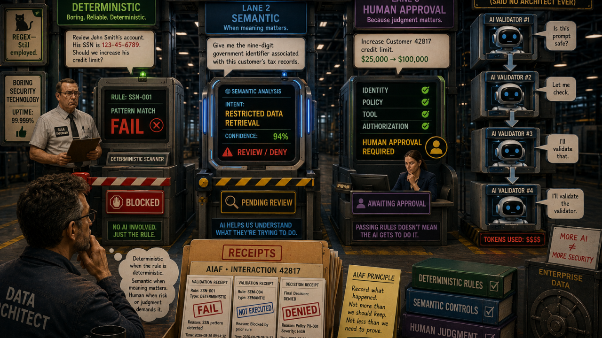

# AI Has Your Data. Now What? #4

**Should an AI Decide Whether Another AI Is Safe?**
**Author:** Kevin Wilkie, MBA
**Published:** September 10, 2026
**Original:** [LinkedIn article](https://www.linkedin.com/pulse/ai-has-your-data-now-what-4-kevin-wilkie-mba-msi5e/)



> **Historical article:** This is an archival Markdown edition of the published article. Its SQL examples document the framework's development at the time and are not the current deployment instructions. See [Getting Started](../GETTING_STARTED.md) and [Testing](../TESTING.md) for the supported implementation.

In the last article, our AI security control did exactly what we wanted.

A user entered a prompt containing something that looked like a Social Security number.

We detected it.

We blocked the request.

The model never saw it.

Then we logged the entire thing and created another sensitive data store.

Good times.

We fixed that by separating:

Audit Metadata

Sanitized Interaction History

Restricted Raw Evidence

And we established another important rule: Classify before you persist.

Which raises the next question.

How exactly are we doing that classification?

Because there's a very tempting answer.

Ask another AI.

## AI All the Way Down
Suppose a user submits:

Review John Smith's account. His SSN is 123-45-6789. Should we increase his credit limit?
We could send that prompt to a second model and ask:

Does this contain sensitive information?
The model responds:

Yes. The prompt contains a Social Security number.
Perfection.

Except...

Our organizational policy says Social Security numbers must not be submitted to an AI model.

So to determine whether we're allowed to submit the prompt to an AI model...

we submitted the prompt to an AI model.

That feels like we may have missed a step.

## Sometimes Boring Is Beautiful
Data professionals already have tools for identifying certain kinds of information.

Regular expressions.

Pattern matching.

Checksums.

Reference tables.

Allow lists.

Deny lists.

Schemas.

Data types.

Constraints.

Rules.

They aren't exciting.

Nobody is going to announce: Revolutionary Regex-Powered Enterprise Security Platform!

at the next technology conference.

But boring has an underrated quality in security architecture.

Boring can be deterministic.

Given the same input and the same rule, we get the same result.

Consider the datapoint 123-45-6789

We don't need a large language model to tell us that this matches the familiar formatting pattern of a U.S. Social Security number.

A deterministic rule can identify that.

That does not prove it's a real SSN.

It could be fake.

It could be test data.

It could be part of a document explaining SSN formatting.

That's why we should be precise about what our controls actually know.

Our rule knows:

This value matches a prohibited pattern.
And if organizational policy says values matching that pattern aren't permitted to reach the model, that's enough to make an enforcement decision.

No AI required.

## Detection and Policy Are Not the Same Thing
This distinction matters.

A detector might tell us:

Possible SSN pattern detected.
A policy tells us:

Requests containing possible SSNs must not be submitted to this model.
Those are separate decisions.

And we should keep them separate.

Why?

Because tomorrow the policy might change.

Maybe one internally hosted model is approved for Confidential data.

Maybe another model isn't.

Maybe the Accounts Receivable assistant is allowed to process account numbers but the general employee assistant isn't.

Maybe a new CISO arrives and says:

No customer financial identifiers in any generative AI system.
The detector didn't change.

The policy did.

If detection and policy enforcement are tangled together in application code, every policy change becomes a development project.

I'd rather not do that.

## Three Layers of Validation
For AIAF, I want to think about validation in three layers.

### 1. Deterministic Validation
Use it when the rule can be expressed reliably without asking a model to interpret meaning.

Examples might include:

Known identifier patterns
Data classification labels
Allowed data sources
File types
Maximum prompt size
Approved model list
Approved tool list
User/application identity
Role membership
Explicit prohibited values
Schema validation
Request rate or size limits

If the rule is:

This agent may only call these four tools.
we don't need AI to decide whether tool number five is on the list.

It either is or it isn't.

### 2. Semantic Validation
Then there are questions that aren't conveniently answered with an IF statement.

Suppose the prompt says:

I don't need the customer's Social Security number. Just give me the nine-digit government identifier associated with their tax records.
No SSN pattern appears in the request.

No sensitive value has been supplied.

The user is asking the AI to retrieve one.

A regular expression isn't going to save us there.

Now we need to understand intent.

This is where semantic analysis can help.

A model may classify the request as: Attempt to retrieve restricted personal information.

That's useful.

But notice what we're doing.

We're using AI where meaning matters.

Not where a lookup table would have done the job just fine.

### 3. Human Validation
And then there are decisions where neither a deterministic rule nor another model should have final authority.

Imagine an agent requests:

Increase Customer 42817's credit limit from $25,000 to $100,000.
Maybe every automated validation passes.

The user is authorized.

The account exists.

The requested amount is within a technically permitted range.

The agent used an approved tool.

That still doesn't mean the AI should have unilateral authority to make the change.

Some decisions require a person.

We'll get much deeper into human approval when we give our agent the ability to modify data later in this series.

For now, the important point is: Not every valid request should be automatically executed.

## Validation Should Be a Pipeline Too
That gives us something like:

```text
Request
   ↓
Deterministic Validation
   ↓
Semantic Validation
   ↓
Policy Decision
   ↓
Human Approval, if required
   ↓
Execution
```
Not every interaction needs every step.

That's important.

If deterministic validation rejects the request, why spend tokens asking a model about it?

If policy says the user cannot access the requested data source, we don't need a philosophical discussion with an LLM.

Stop processing.

This isn't only a security benefit.

It's cheaper.

It's faster.

And it's easier to explain later.

## "Why Was My Request Denied?"
That's another advantage of deterministic controls.

Suppose someone asks why their request failed.

Which answer would you rather give them?

The security model evaluated your request and determined that it presented a 78% probability of violating our sensitive-data policy.

Or:

Policy PII-001 prohibits SSN-formatted values from being submitted to this model. Your request matched rule SSN-001 and was blocked.

I'll take Door #2.

Especially when an auditor asks the same question.

## Building AIAF: Validation Rules
Let's start capturing these rules.

```sql
CREATE TABLE aiaf.ValidationRule
(
    ValidationRuleId      bigint IDENTITY(1,1) NOT NULL,
    RuleCode              varchar(50) NOT NULL,
    RuleName              nvarchar(200) NOT NULL,
    ValidationType        varchar(30) NOT NULL,
    Description           nvarchar(1000) NULL,
    RuleDefinition        nvarchar(max) NULL,
    Severity              varchar(20) NOT NULL,
    IsActive              bit NOT NULL,
    CreatedOn             datetime2(7) NOT NULL
        CONSTRAINT DF_ValidationRule_CreatedAt
        DEFAULT SYSUTCDATETIME(),

    CreatedBy             nvarchar(200) NOT NULL,

    CONSTRAINT PK_ValidationRule
        PRIMARY KEY (ValidationRuleId),

    CONSTRAINT UQ_ValidationRule_RuleCode
        UNIQUE (RuleCode),

    CONSTRAINT CK_ValidationRule_Type
        CHECK (ValidationType IN
            ('DETERMINISTIC', 'SEMANTIC', 'HUMAN'))
);
```
Notice RuleDefinition.

For a deterministic rule, that might eventually contain configuration describing a pattern, threshold, allow list, or other test.

For semantic validation, it might reference a versioned classifier or validation prompt.

We're not implementing every possible validator inside SQL Server.

SQL Server is recording what rule existed and what happened when it ran.

That's an important distinction.

## Then Capture the Result
We also need to know what happened when each rule was evaluated.

```sql
CREATE TABLE aiaf.ValidationResult
(
    ValidationResultId    bigint IDENTITY(1,1) NOT NULL,
    InteractionId         bigint NOT NULL,
    ValidationRuleId      bigint NOT NULL,
    Result                varchar(20) NOT NULL,
    ConfidenceScore       decimal(5,4) NULL,
    ResultDetail          nvarchar(1000) NULL,
    EvaluatedAt           datetime2(7) NOT NULL
        CONSTRAINT DF_ValidationResult_EvaluatedAt
        DEFAULT SYSUTCDATETIME(),

    CONSTRAINT PK_ValidationResult
        PRIMARY KEY (ValidationResultId),

    CONSTRAINT FK_ValidationResult_Interaction
        FOREIGN KEY (InteractionId)
        REFERENCES aiaf.AIInteraction (InteractionId),

    CONSTRAINT FK_ValidationResult_Rule
        FOREIGN KEY (ValidationRuleId)
        REFERENCES aiaf.ValidationRule (ValidationRuleId),

    CONSTRAINT CK_ValidationResult_Result
        CHECK (Result IN
            ('PASS', 'FAIL', 'REVIEW', 'ERROR'))
);
```
Now an interaction can accumulate evidence:

```text
Interaction: 42817

SSN-001
Type: DETERMINISTIC
Result: FAIL
Detail: SSN-formatted value detected

SEM-004
Type: SEMANTIC
Result: NOT EXECUTED

Final Decision:
DENIED
```
That tells us something useful.

We didn't merely record: Security said no.

We know which control made the decision.

## But We're Missing Something
There's a problem with our ValidationRule table.

Suppose SSN-001 changes.

Maybe we improve the pattern.

Maybe the threshold changes.

Maybe the semantic classifier gets a new prompt.

If we simply update the row, then six months from now our audit trail points to today's rule.

Not the rule that actually evaluated the interaction.

We've made the exact mistake we avoided with prompt definitions.

So validation rules need versions too.

And policies definitely need versions.

We're going to need to know:

Which rule, under which policy, made this decision at that moment?
Because the organization's definition of "safe" isn't static.

Which leads us directly to the next problem.

## Then the New CISO Arrives
Imagine we have six months of AI interactions.

Thousands of them were perfectly acceptable under the organization's policies at the time.

Then the security policy changes.

Something we allowed yesterday isn't allowed today.

That's normal.

But now I want to ask a much more interesting question:

How many historical interactions would fail if we evaluated them against today's rules?

That's where keeping sanitized interaction history starts paying off.

We don't have to shrug and say:

Well, that's how we used to do it.

We can test it.

We can take historical interactions.

Apply today's policy.

Measure the impact.

Identify applications that need remediation.

And understand the blast radius before flipping the switch.

That's where we're headed next.

Because AI security isn't something we approve once and frame on the wall.

Models change.

Applications change.

Users change.

And security leadership definitely changes.

Yesterday's safe AI isn't necessarily today's safe AI.
