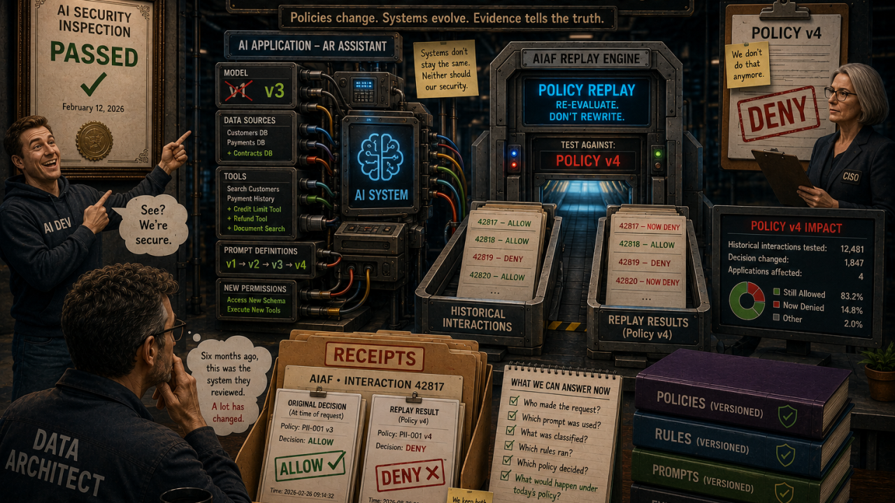

# AI Has Your Data. Now What? #5

**Your AI Passed Security Review Six Months Ago. So What?**
**Author:** Kevin Wilkie, MBA
**Published:** September 17, 2026
**Original:** [LinkedIn article](https://www.linkedin.com/pulse/ai-has-your-data-now-what-5-kevin-wilkie-mba-eyd9e/)



> **Archive note:** This article preserves the original published narrative and early SQL design examples. These are historical learning examples, not the current database deployment sequence. For current installation, see [Getting Started](../GETTING_STARTED.md).

We did it.

The AI application passed security review.

Everyone signed off.

The data sources were approved.

The service principal uses least privilege.

Prompts are classified before they're persisted.

Sensitive information gets blocked.

Validation rules are documented.

Audit records are being created.

Someone probably even updated the architecture diagram.

Ship it.

Six months later...

The model has changed.

The system prompt has changed four times.

Three new tools have been added.

Users have figured out entirely new ways to ask questions.

The application can access another data source.

Two validation rules were modified.

And there's a new CISO.

But don't worry.

The application passed security review six months ago.

Security Approval Is a Point-in-Time Statement
This isn't really an AI problem.

We've seen this movie several times before.

A system goes through security review.

At that moment, someone evaluates:

this application

using:

this architecture

with:

these permissions

against:

these policies

and determines that the risk is acceptable.

That's useful.

But somewhere along the way, organizations can start treating: Approved on February 12

as if it means: Secure forever.

It doesn't.

It means:

Based on what we knew and required on February 12, this system was approved.
AI makes that distinction especially important because so many pieces can change independently.

Yesterday's Safe Request
Let's return to our Sherpa of Data AR Assistant.

Suppose our original policy allowed customer account numbers to be submitted to our approved model.

An interaction occurs:

Review account 8675309 and summarize its payment history.
The user is authorized.

The account number is classified as Confidential.

The model is approved for Confidential information.

Every validation passes.

The request is allowed.

AIAF records the decision.

Three months later, security policy changes.

The new policy says:

Customer account identifiers may not be submitted to generative AI models.
If that same request arrives today, it should be denied.

So, was the original request a security failure?

Not at all.

That's important.

The interaction complied with the policy that existed when it occurred.

Our audit trail should preserve that fact.

We don't rewrite history because the rules changed.

But we should absolutely be able to ask:

How much of our historical AI activity would violate the policy we have today?
That's a very different—and extremely useful—question.

Policy Drift
Earlier in this series, I mentioned several kinds of AI drift.

This is a huge one.

The AI may not have changed at all.

The prompt may not have changed.

The data may not have changed.

The model may not have changed.

What changed was the organization's definition of acceptable behavior.

That means an AI application can drift out of compliance without changing a single line of code.

That's worth thinking about.

Rules Are Not Policies
In the last article, we separated detection from policy.

A validation rule might tell us:

Customer account identifier detected.
That's an observation.

The policy decides what that observation means.

Under Policy Version 1:

```text
Customer Account Identifier
Classification: Confidential
Approved Model: YES
Decision: ALLOW
Under Policy Version 2:
```

```text
Customer Account Identifier
Classification: Confidential
Approved Model: NO
Decision: DENY
Same detector.
```

Same input.

Different organizational policy.

This is why I don't want rules scattered through Python that look something like this:

```python
if contains_account_number(prompt):
    deny_request()
Maybe that's today's decision.
```

But where is the policy?

When did it become effective?

What policy did it replace?

Who approved it?

Which applications does it apply to?

Which models?

Which classifications?

And six months from now, can we prove which version was used?

We've already learned this lesson with prompts.

Now we're going to apply it to policy.

Building AIAF: Versioned Policies
Let's create a policy definition.

```sql
CREATE TABLE aiaf.Policy
(
    PolicyId              bigint IDENTITY(1,1) NOT NULL,
    PolicyCode            varchar(50) NOT NULL,
    PolicyName            nvarchar(200) NOT NULL,
    Description           nvarchar(1000) NULL,
```

CONSTRAINT PK_Policy
        PRIMARY KEY (PolicyId),

CONSTRAINT UQ_Policy_PolicyCode
        UNIQUE (PolicyCode)
);
The policy itself gets a stable identity.

Its implementation gets versions.

```sql
CREATE TABLE aiaf.PolicyVersion
(
    PolicyVersionId       bigint IDENTITY(1,1) NOT NULL,
    PolicyId              bigint NOT NULL,
    VersionNumber         int NOT NULL,
    EffectiveFrom         datetime2(7) NOT NULL,
    EffectiveTo           datetime2(7) NULL,
    PolicyDefinition      nvarchar(max) NOT NULL,
    ApprovedBy            nvarchar(200) NOT NULL,
    ApprovedAt            datetime2(7) NOT NULL,
    CreatedAt             datetime2(7) NOT NULL
        CONSTRAINT DF_PolicyVersion_CreatedAt
        DEFAULT SYSUTCDATETIME(),
```

CONSTRAINT PK_PolicyVersion
        PRIMARY KEY (PolicyVersionId),

CONSTRAINT FK_PolicyVersion_Policy
        FOREIGN KEY (PolicyId)
        REFERENCES aiaf.Policy (PolicyId),

CONSTRAINT UQ_PolicyVersion
        UNIQUE (PolicyId, VersionNumber)
);
Now we can preserve:

Policy PII-001, Version 1

and:

Policy PII-001, Version 2

without pretending Version 2 has always existed.

Which Policy Made the Decision?
Next, we need to record the policy decision made for an interaction.

```sql
CREATE TABLE aiaf.PolicyDecision
(
    PolicyDecisionId      bigint IDENTITY(1,1) NOT NULL,
    InteractionId         bigint NOT NULL,
    PolicyVersionId       bigint NOT NULL,
    Decision              varchar(20) NOT NULL,
    DecisionReason        nvarchar(1000) NULL,
    EvaluatedAt           datetime2(7) NOT NULL
        CONSTRAINT DF_PolicyDecision_EvaluatedAt
        DEFAULT SYSUTCDATETIME(),
```

CONSTRAINT PK_PolicyDecision
        PRIMARY KEY (PolicyDecisionId),

CONSTRAINT FK_PolicyDecision_Interaction
        FOREIGN KEY (InteractionId)
        REFERENCES aiaf.AIInteraction (InteractionId),

CONSTRAINT FK_PolicyDecision_PolicyVersion
        FOREIGN KEY (PolicyVersionId)
        REFERENCES aiaf.PolicyVersion (PolicyVersionId),

CONSTRAINT CK_PolicyDecision_Decision
        CHECK (Decision IN
            ('ALLOW', 'DENY', 'REVIEW'))
);
Now when someone asks:

Why did Interaction 42817 run?
we don't have to say:

Well, I looked at the current Python code and I think...
We can say:

Interaction 42817 was evaluated under Policy PII-001 Version 3. It was allowed because customer account identifiers were permitted for that application and model at the time.
That's an audit trail.

Then the New CISO Arrives
Now let's make things interesting.

Our new CISO changes the policy.

Customer account identifiers are no longer permitted.

We could deploy the new policy and wait.

Requests begin failing.

Users begin calling.

Applications begin breaking.

Someone creates a Sev 2 ticket titled:

AI IS DOWN

And eventually somebody discovers that the AI isn't down at all.

It's doing exactly what the new policy told it to do.

There is another option.

Replay history first.

Policy Replay
Because we've been keeping sanitized interaction history, we have something incredibly valuable.

Examples of how the AI application has actually been used.

Before activating Policy Version 4, we can take historical interactions and evaluate them against it.

Not execute them again.

Not send them back to the model.

Not perform their tool calls again.

Just reevaluate the retained evidence against the proposed policy.

Conceptually:

```text
Historical Interaction
        ↓
Sanitized Evidence
        ↓
Proposed Policy Version
        ↓
Validation / Classification
        ↓
Historical Decision: ALLOW
Proposed Decision:   DENY
        ↓
POLICY IMPACT
Now we can ask:
```

How many interactions would change?
Even better:

Which applications would be affected?
Which users?
Which classifications?
Which prompt types?
Which business processes?
Now security can make the policy change with some idea of the blast radius.

That's considerably better than finding out Monday morning.

Building AIAF: Replay Results
We don't want policy replay to overwrite the original decision.

That would destroy the evidence we're trying to preserve.

So, the replay gets its own record.

```sql
CREATE TABLE aiaf.PolicyReplayResult
(
    PolicyReplayResultId  bigint IDENTITY(1,1) NOT NULL,
    InteractionId         bigint NOT NULL,
    OriginalPolicyVersionId bigint NOT NULL,
    ReplayPolicyVersionId   bigint NOT NULL,
    OriginalDecision      varchar(20) NOT NULL,
    ReplayDecision        varchar(20) NOT NULL,
    DecisionChanged       bit NOT NULL,
    ReplayReason          nvarchar(1000) NULL,
    ReplayedAt            datetime2(7) NOT NULL
        CONSTRAINT DF_PolicyReplayResult_ReplayedAt
        DEFAULT SYSUTCDATETIME(),
```

CONSTRAINT PK_PolicyReplayResult
        PRIMARY KEY (PolicyReplayResultId),

CONSTRAINT FK_PolicyReplayResult_Interaction
        FOREIGN KEY (InteractionId)
        REFERENCES aiaf.AIInteraction (InteractionId),

CONSTRAINT FK_PolicyReplayResult_OriginalPolicy
        FOREIGN KEY (OriginalPolicyVersionId)
        REFERENCES aiaf.PolicyVersion (PolicyVersionId),

CONSTRAINT FK_PolicyReplayResult_ReplayPolicy
        FOREIGN KEY (ReplayPolicyVersionId)
        REFERENCES aiaf.PolicyVersion (PolicyVersionId)
);
Now our original evidence remains untouched.

Interaction 42817 still says:

```text
Original Policy:   PII-001 v3
Original Decision: ALLOW
Our replay says:
```

```text
Tested Against:    PII-001 v4
Replay Decision:   DENY
Decision Changed:  YES
Those records mean different things.
```

We should preserve both.

This Isn't Just About the CISO
Security leadership makes for fun examples.

But policy changes for plenty of reasons.

A new regulation.

A new customer contract.

A new data classification.

A model gets approved for additional data.

A model loses approval.

An internal model replaces an external one.

A business unit gets new capabilities.

A vulnerability is discovered.

An agent receives a new tool.

A data source changes classification.

The question remains the same:

What does this change mean for how our AI applications are actually being used?
If we've retained useful evidence, we can answer it.

And Sometimes the Policy Gets Less Restrictive
Policy replay isn't only about finding new violations.

Suppose we deploy an internally hosted model approved for Restricted information.

Requests that were previously denied may now be acceptable.

Historical replay could tell us:

14% of requests denied last quarter could now be safely supported by the new architecture.
That's useful too.

Security isn't supposed to exist solely to say no.

Good security architecture should also help us understand when we can safely say yes.

Don't Confuse Replay With Re-execution
There's an important boundary here.

When I say replay historical interactions, I am not suggesting that we blindly rerun historical agent activity.

If an interaction originally said:

Refund this customer $500.
we absolutely do not want a quarterly policy review issuing another $500 refund.

We're replaying the security decision.

Not the business action.

That distinction becomes extremely important once we start giving agents tools.

And yes.

We're getting there.

Security Review Becomes Continuous
The traditional security review still matters.

Before an application goes live, someone should evaluate the architecture.

But that shouldn't be the end of the story.

Once AIAF gives us historical evidence, we can continually ask better questions.

What changed?

What would today's policy reject?

What newly approved capabilities could we enable?

Which applications are most affected by policy changes?

Where are users repeatedly attempting things that policy doesn't allow?

Are our controls still appropriate for how the system is actually being used?

Now security review starts becoming something more useful than a document created before launch and rediscovered during the next audit.

It becomes an operational process.

One Problem Down. Another One Waiting.
At this point, we know quite a bit about an interaction.

We know who requested it.

We know which prompt definition was used.

We know how the request was classified.

We know which validation rules ran.

We know which policy version made the decision.

We can even test historical interactions against new policies.

That's pretty good.

Except we're still missing something enormous.

Suppose the user asks:

Which of our customers appear most likely to leave us?
The AI answers.

Six months later, we have the exact prompt.

We have the model.

We have the policy.

We have the user.

We have the response.

Great.

But what customer records did the AI actually use to produce that answer?

Which documents?

Which database results?

Which version of those records?

What information was retrieved but never shown to the user?

Because the user's prompt isn't necessarily where the sensitive data came from.

Sometimes the dangerous part is what happens after the prompt.

In the next article, we're going to follow the data.

Because your AI didn't just read the prompt.

It read the context too.
