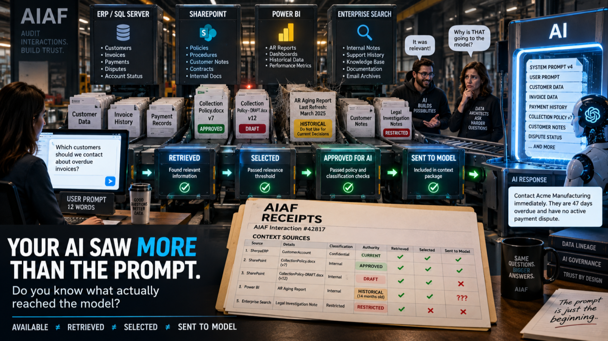

# AI Has Your Data. Now What? #6

**Your AI Didn’t Just Read the Prompt**
**Author:** Kevin Wilkie, MBA
**Published:** September 24, 2026
**Original:** [LinkedIn article](https://www.linkedin.com/pulse/ai-has-your-data-now-what-6-kevin-wilkie-mba-wq2be/)



> **Archive note:** This article preserves the published narrative and illustrative SQL definitions as historical educational material. They are not the supported installation sequence. See [Getting Started](../GETTING_STARTED.md) for the current AIAF installer.

We have spent the last few articles talking about what goes into an AI interaction.

The prompt.

The identity of the person making the request.

The version of the prompt being used.

The classifications of the data involved.

The validation rules.

The security policies.

All important things.

But there is a rather large piece of the interaction we haven't talked about yet.

The AI may have received a whole bunch of information the user never typed.

Welcome to context.

And this is where our audit trail starts getting considerably more interesting.

## The Prompt Is Only the Beginning
Imagine someone asks our fictional Sherpa of Data Accounts Receivable Assistant:

Which customers should we contact about overdue invoices?
That's the user prompt.

We've already established that we want to know who asked it, when they asked it, and which version of our system instructions applied.

But our application probably doesn't just send that sentence to the model.

It may retrieve:

Customer information
Open invoices
Payment history
Account status
Collection notes
Customer contacts
Active disputes
Previous interactions

Maybe it performs a vector search.

Maybe it executes SQL.

Maybe it calls an API.

Maybe another agent gathered some of the information.

All of that gets assembled into a nice package and handed to the model.

The user typed twelve words.

The AI may have received 40,000 tokens.

When somebody asks:

"What did the user ask?"
that's useful.

But when we're investigating an AI interaction, the much more important question may be:

What did the AI actually see?
## Welcome to RAG
This is where Retrieval-Augmented Generation - RAG - enters our story.

The basic idea is straightforward.

Instead of expecting the model to know everything, we retrieve information relevant to the user's question and provide that information to the model as context.

Something like:

```text
User Question
      ↓
Retrieve Relevant Information
      ↓
Build Context
      ↓
Send Question + Context to Model
      ↓
Generate Response
```
Which is a pretty useful pattern.

It allows an AI application to answer questions using enterprise information that wasn't part of the model's original training.

Fantastic.

We have successfully given the AI access to our data.

Which, given the title of this series, should probably make everyone slightly nervous by now.

## RAG Is a Data Pipeline
RAG is often discussed as an AI technique.

From a data architecture perspective, I think that's incomplete.

RAG is also a data pipeline.

Data is:

Located.
Retrieved.
Filtered.
Ranked.
Transformed.
Combined.
Sent somewhere else.

We have spent decades worrying about lineage when data moves through ETL pipelines.

Source system.

Transformation.

Destination.

Who changed it.

When it changed.

Where it came from.

Then we built RAG systems and sometimes reduced all of that to:

Context = "Here are some documents."
Fun times.

## Where Did This Answer Come From?
Suppose our AR Assistant returns:

We should contact Acme Manufacturing immediately. They are 47 days overdue and have no active payment dispute.
Seems reasonable.

Now Acme calls.

They absolutely do have an active dispute.

Hence we investigate.

The user prompt hasn't changed.

The system prompt hasn't changed.

The model hasn't changed.

The policy hasn't changed.

Everything we've built in AIAF so far looks perfectly normal.

Except the answer was wrong.

Why?

Maybe the retrieval query excluded the dispute record.
Maybe the dispute was entered five minutes after the context was retrieved.
Maybe the search ranked an old customer note above the new one.
Maybe the application retrieved data from the wrong environment.
Maybe a stale Power BI report was indexed as enterprise knowledge.
Maybe somebody's draft documentation said something different from the approved documentation.
Maybe the model was given both.

And now we have a problem that isn't really about the model.

It's about data lineage.

## "The Document Is in SharePoint" Isn't Lineage
Imagine we ask the AI why Acme was included.

Our logs say:

Context Source: SharePoint
Wonderful.

Now we have many more questions:

Which document?
Which version?
Published or draft?
When was it retrieved?
Which section was used?
What classification did it have?
Was the document still considered authoritative?
Was it superseded?
Did the retrieval system return the entire document or three chunks?
What were those chunks?
What other documents were considered but not selected?

Suddenly:

Source = SharePoint
isn't especially helpful.

The same applies to:

Source = SQL Server
Great.

Which database?

Which table or approved data interface?

Which query?

What rows?

At what point in time?

## AI Needs Data Lineage Too
Traditional lineage usually tries to answer:

Where did this data come from?
For AI interactions, we need to extend that question:

Which information actually influenced this interaction?
Those are not quite the same thing.

Suppose retrieval considers 100 documents.

Ten pass the relevance threshold.

Five are selected.

Three survive a later context-size limit.

Those three are ultimately sent to the model.

There are several potentially useful pieces of evidence there.

But the most important distinction is:

What was available isn't necessarily what was retrieved.

What was retrieved isn't necessarily what was selected.

What was selected isn't necessarily what the model received.

That distinction matters.

A lot.

## Context Has a Distinct Lifecycle
Our AI interaction pipeline is getting longer again.

Earlier, we had something resembling:

```text
Request
   ↓
Classify
   ↓
Sanitize
   ↓
Validate
   ↓
Authorize
   ↓
Execute
```
Now we need to look inside that execution stage.

Request
   ↓
Classify
   ↓
Validate
   ↓
Authorize
   ↓
Retrieve Context
   ↓
Evaluate Context
   ↓
Assemble Context
   ↓
Send Approved Context to Model
   ↓
Generate Response
And each step creates questions.

Did the requestor have permission to retrieve the source?
Was the source approved for AI use?
What classification was retrieved?
Was sensitive content removed?
Was the content current?
Was the source authoritative?
Which version was retrieved?
Did all retrieved information actually reach the model?

This is starting to look suspiciously like data engineering.

Imagine that.

## Authorization Doesn't End at Retrieval
Here's another subtle problem.

Suppose Alice works in Accounts Receivable.

Alice is authorized to see:

Customer Name
Invoice Number
Invoice Amount
Invoice Date
Payment Status
She is not authorized to see:

Employee Notes
Legal Investigation Notes
Executive Commentary
Our retrieval process searches a giant enterprise knowledge index.

It finds a highly relevant internal note:

Customer is currently part of an internal fraud investigation. Do not contact until Legal approves.
The AI uses that information and responds:

Do not contact this customer.
Did the AI reveal the restricted note?

Not directly.

But restricted information influenced the answer.

That matters.

Access control can't only ask:

Can Alice see the final response?
We also need to ask:

Was the AI allowed to use this information while producing Alice's response?
That's a very different security boundary.

## Retrieval Can Leak Without Quoting
This is one of the things that makes AI security interesting.

A model doesn't have to repeat restricted information word-for-word to reveal something about it.

Suppose an employee asks:

Should we renew this customer's contract?
The AI responds:

I recommend against renewal due to unresolved internal concerns.
The employee never saw the restricted Legal document.

But the answer was influenced by it.

Maybe that's allowed.

Maybe it isn't.

The important part is that the organization should make that decision intentionally.

Not accidentally because the vector search returned a really relevant chunk.

## And Then There Are Drafts
This is where enterprise knowledge systems can get especially entertaining.

Imagine we have two documents:

Customer Refund Policy.docx
Customer Refund Policy - DRAFT.docx
The approved policy says:

Refunds above $5,000 require manager approval.
The draft says:

Refunds above $10,000 require manager approval.
Someone is working on the draft.

It hasn't been approved.

It hasn't gone live.

But both documents are indexed.

The user asks:

Can I issue a $7,500 refund without approval?
The AI retrieves the draft.

And confidently says: "Yes."

Technically, the AI found enterprise documentation.

It just found the wrong enterprise documentation.

This is why "connect the AI to SharePoint" isn't a governance strategy.

## Stale Data Is Still Data
The same problem applies to reports.

Maybe the organization has an old Power BI report.

The business wants to keep it for historical reference.

Nobody plans to update it anymore.

That's perfectly reasonable.

Until the AI starts treating it as current truth.

A human looking at the report might notice: Last Refresh: March 2025

An AI retrieval pipeline may simply see a highly relevant source.

Context governance needs concepts like:

Authoritative
Historical
Superseded
Draft
Expired
Current
Reference only
Approved for AI
Not approved for AI

Because available and authoritative are not synonyms.

## Building AIAF: Context Lineage
Time to add another receipt.

We need to represent the context associated with an interaction.

Let's start with the context package itself.

```sql
CREATE TABLE aiaf.AIContext
(
    AIContextId bigint IDENTITY(1,1) NOT NULL
        CONSTRAINT PK_AIContext PRIMARY KEY,

    InteractionId bigint NOT NULL,
    ContextType varchar(50) NOT NULL,

    AssembledAt datetime2(3) NOT NULL
        CONSTRAINT DF_AIContext_AssembledAt
        DEFAULT (SYSUTCDATETIME()),

    CONSTRAINT FK_AIContext_AIInteraction
        FOREIGN KEY (InteractionId)
        REFERENCES aiaf.AIInteraction (InteractionId)
);
```
An interaction might eventually have multiple context packages.

For example:

SYSTEM_CONTEXT
RETRIEVAL_CONTEXT
TOOL_CONTEXT
AGENT_CONTEXT
But knowing that context existed isn't enough.

We need the sources.

## AIContextSource
Let's add them.

```sql
CREATE TABLE aiaf.AIContextSource
(
    AIContextSourceId bigint IDENTITY(1,1) NOT NULL
        CONSTRAINT PK_AIContextSource PRIMARY KEY,

    AIContextId bigint NOT NULL,
    SourceType varchar(50) NOT NULL,
    SourceSystem nvarchar(200) NOT NULL,
    SourceIdentifier nvarchar(1000) NOT NULL,
    SourceVersion nvarchar(200) NULL,
    RetrievedAt datetime2(3) NOT NULL,
    WasSelected bit NOT NULL,
    WasSentToModel bit NOT NULL,
    AuthorityStatus varchar(50) NULL,

    CONSTRAINT FK_AIContextSource_AIContext
        FOREIGN KEY (AIContextId)
        REFERENCES aiaf.AIContext (AIContextId)
);
```
Now Interaction 42817 might tell us:

Context: 9134

Source 1
--------
Type: SQL
System: SherpaERP
Identifier: CustomerAccount
Version: N/A
Selected: Yes
SentToModel: Yes
Authority: CURRENT

Source 2
--------
Type: DOCUMENT
System: SharePoint
Identifier: /Finance/CollectionPolicy.docx
Version: 7
Selected: Yes
SentToModel: Yes
Authority: APPROVED

Source 3
--------
Type: DOCUMENT
System: SharePoint
Identifier: /Finance/CollectionPolicy-DRAFT.docx
Version: 12
Selected: Yes
SentToModel: No
Authority: DRAFT
Now we're getting somewhere.

## Why Record Something That Wasn't Sent?
You might look at that third source and ask:

Why keep it?

Because it tells us something about the retrieval system.

The system found the draft.

Our control prevented it from reaching the model.

That's useful evidence.

Six months from now, if we discover that draft documents were frequently being retrieved, we have something worth investigating.

Maybe our search scope is wrong.

Maybe our metadata is terrible.

Maybe people are storing approved and draft content in the same location without meaningful classification.

The AI system may be exposing a governance problem that already existed.

AI has a funny habit of doing that.

## Do We Store the Context Itself?
And now we arrive at our old friend from Article #3.

Should we save everything the model saw?

Maybe.

But absolutely not by default.

Context can contain:

PII
Financial information
Contracts
Internal notes
Employee information
Legal material
Confidential business information

If we blindly copy every retrieved chunk into AIAF, congratulations:

We built another sensitive-data warehouse.

Again.

Sadly, the same principle applies:

Capture enough evidence to reconstruct the interaction without unnecessarily duplicating the underlying data.
Sometimes that means storing:

Source
Document ID
Version
Chunk ID
Hash
Classification
Retrieval timestamp
rather than storing the entire chunk.

If the authoritative source retains the exact version, we may be able to reconstruct it later.

If it doesn't?

Then we have a harder architectural decision to make.

There isn't one universal answer.

And pretending there is would be convenient but wrong.

## Hashes Become Interesting Here
Suppose we record:

DocumentId: FIN-POL-004
Version: 7
Chunk: 14
SHA256: ABC123...
Later, we retrieve version 7, chunk 14.

If the hash matches, we have strong evidence that we're looking at the same content that was supplied during the original interaction.

If it doesn't?

Something changed.

This doesn't solve all of our audit problems.

But it gives us another receipt.

And we'll have much more to say about hashes when we get to tamper evidence later in the series.

## Context Should Have Classification Too
Remember our classification tables from Article #3?

They're becoming even more useful.

Classification doesn't only apply to the user's prompt.

It applies to retrieved context.

If our AI receives:

Public
Internal
Confidential
Restricted
information during the same interaction, we should know that.

Eventually, AIAF should let us answer questions like:

Show me every AI interaction in the last 90 days where Restricted information entered model context.
Or:

Which models received Confidential customer information?
Or:

Which applications are retrieving Draft documents?
Or my personal favorite:

Why has this AI been using a Power BI report that hasn't refreshed in fourteen months?
Those are architecture questions.

They're governance questions.

They're security questions.

And now they're queryable.

## The Model Is Downstream of Your Data Architecture
There's a tendency to blame the model whenever an AI answer is wrong.

Sometimes that's absolutely where the problem is.

But sometimes the model faithfully answered based on exactly what we gave it.

The wrong document.

The stale report.

The outdated customer record.

The unauthorized note.

The draft nobody approved.

The model didn't invent the problem.

We delivered it.

That's why AI readiness has so much less to do with AI than people expect.

Metadata matters.

Classification matters.

Ownership matters.

Lifecycle matters.

Authority matters.

Lineage matters.

The AI is simply making our existing data architecture much harder to ignore.

## Keep the Context Receipts
Our AIAF receipt is getting thicker.

For an interaction, we're beginning to capture:

Interaction
    ↓
Requestor
    ↓
Prompt Definition + Version
    ↓
Classification
    ↓
Validation
    ↓
Policy Decision
    ↓
Context Package
    ↓
Context Sources
        ├── Source System
        ├── Source Identifier
        ├── Version
        ├── Classification
        ├── Authority
        ├── Retrieved
        ├── Selected
        └── Sent To Model
We're getting closer to answering: "What actually happened?"

But there's another problem waiting for us.

Suppose we know the exact prompt.

We know the exact system instructions.

We know the exact context.

We know the exact policy.

We know the model.

Surely we can reproduce the answer now.

Right?

Well...

AI has one more surprise for us.

Next time:

Can You Reproduce What Your AI Said Tuesday?
Because having the receipts and being able to recreate the meal aren't necessarily the same thing.
