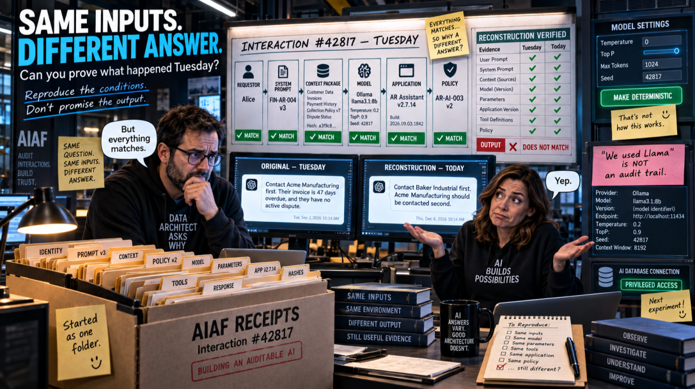

# AI Has Your Data. Now What? #7

**Can You Reproduce What Your AI Said Tuesday?**
**Author:** Kevin Wilkie, MBA
**Published:** October 1, 2026
**Original:** [LinkedIn article](https://www.linkedin.com/pulse/ai-has-your-data-now-what-7-kevin-wilkie-mba-z6oxe/)



> **Archive note:** This article preserves the published narrative and illustrative SQL definitions as historical educational material. They are not the supported installation sequence. See [Getting Started](../GETTING_STARTED.md) for the current AIAF installer.

We have receipts.

Lots of receipts.

By this point in our AI Interaction Audit Framework, we're starting to know quite a bit about an AI interaction.

We know who initiated it.

We know which prompt definition was used.

We know which version of that prompt was active.

We know what classifications were detected.

We know which validation rules ran.

We know which security policy made the decision.

And after our last article, we even know what context was retrieved, selected, approved, and actually sent to the model.

Excellent.

So if somebody walks into our office three months from now and asks:

"Why did the AI tell Alice to contact Acme Manufacturing on Tuesday?"
we should be able to reproduce the interaction.

Right?

We have everything.

Let's push the button again.

And...

The AI gives us a different answer.

Fun times.

## Same Question. Different Answer.
Let's go back to our fictional Sherpa of Data Accounts Receivable Assistant.

On Tuesday, Alice asks:

Which customers should we contact about overdue invoices?
The AI responds:

Contact Acme Manufacturing first. Their invoice is 47 days overdue, and they have no active dispute.
A few months later, we're investigating that interaction.

Thanks to AIAF, we've kept some pretty good receipts.

We reconstruct:

Requestor: Alice
Application: AR Assistant

User Prompt:
Which customers should we contact about overdue invoices?

System Prompt:
FIN-AR-004 v3

Context:
Customer Account #42817
Invoice #INV-10482
Payment History
Collection Policy v7
Dispute Status

Policy:
AR-AI-003 v2

Model:
llama3.1
Perfect.

We rebuild the context.

We submit the exact same request.

And now the model says:

Contact Baker Industrial first. Acme Manufacturing should be contacted second.
Nothing is obviously wrong.

The model simply produced a different answer.

Welcome to reproducibility in generative AI.

## We Need to Define "Reproduce"
Before we go any further, there's an important distinction.

When people say: "Can we reproduce the AI interaction?"

they may mean several different things.

Can we reproduce the inputs?
Can we reconstruct what the system sent to the model?

Can we reproduce the environment?
Can we reconstruct which model, parameters, tools, policies, and application configuration were in effect?

Can we reproduce the exact output?
Can we make the model generate the identical response again?

Those are not the same problem.

And AIAF should not pretend they are.

Our goal isn't necessarily:

Make the AI say exactly the same sentence again.
Our more important goal is:

Reconstruct the conditions under which the original response was produced.
That's something we can actually design for.

## "We Used Llama" Isn't Enough
Let's look at that interaction receipt again.

Model: llama3.1
That sounds useful.

Until somebody asks:

Which one?
Which version?
Which build?
Which quantization?
Which provider?
Which endpoint?
Was it local?
Was it hosted?
Was the model updated between Tuesday and today?
What temperature did we use?
What was top_p?
Was there a seed?
What was the context-window size?
Were there stop sequences?
Was structured output enabled?
What other generation parameters were used?

Suddenly:

Model = llama3.1
starts looking suspiciously like:

Source = SharePoint
from the last article.

Technically true.

Operationally underwhelming.

## Model Identity Is Part of the Receipt
If a model influences an enterprise decision, its identity belongs in our evidence.

At minimum, we want things like:

Provider
Model
Model Version
Deployment / Endpoint
Configuration
Parameters
Depending on the platform, some of those may be straightforward.

Others may not exist in quite the form we'd like.

That's okay.

AIAF isn't about pretending every provider exposes identical metadata.

It's about capturing the strongest evidence the platform makes available.

Provider-neutral does not mean that every model works exactly the same.

It truly means that our architectural requirement survives when the provider changes.

## Building AIAF: Model Execution
Let's add another receipt.

```sql
CREATE TABLE aiaf.AIModelExecution
(
    AIModelExecutionId bigint IDENTITY(1,1) NOT NULL
        CONSTRAINT PK_AIModelExecution PRIMARY KEY,

    InteractionId bigint NOT NULL,
    ProviderName nvarchar(100) NOT NULL,
    ModelName nvarchar(200) NOT NULL,
    ModelVersion nvarchar(200) NULL,
    DeploymentName nvarchar(200) NULL,
    EndpointIdentifier nvarchar(500) NULL,
    Temperature decimal(5,4) NULL,
    TopP decimal(5,4) NULL,
    Seed bigint NULL,
    MaxOutputTokens int NULL,
    StartedAt datetime2(3) NOT NULL,
    CompletedAt datetime2(3) NULL,

    CONSTRAINT FK_AIModelExecution_AIInteraction
        FOREIGN KEY (InteractionId)
        REFERENCES aiaf.AIInteraction (InteractionId)
);
```
Now our receipt is getting considerably better.

Instead of:

Model: llama3.1
we might have:

Provider: Ollama
Model: llama3.1:8b
Model Version: [provider/model identifier]
Temperature: 0.2
TopP: 0.9
Seed: 42817
That's much more useful.

But there's another problem.

## Parameters Change Behavior
Anyone who has played with generative models for more than five minutes has probably encountered temperature.

Higher temperature generally allows more variation.

Lower temperature generally makes output more constrained.

So obviously:

Set temperature to zero and now everything is deterministic.
Problem solved.

We can all go home.

Except...

Temperature zero does not magically turn a generative AI system into a stored procedure.

Depending on the model, provider, infrastructure, implementation, hardware, model updates, routing, and other factors, identical inputs may still not guarantee identical output forever.

Even when a seed is available, reproducibility may have limitations.

That doesn't make the system unusable.

It just means we need to stop applying deterministic expectations to a system that may not be deterministic.

## This Is Where Hashes Get Really Useful
Remember the context hashes we discussed last time?

We can apply the same idea to more of the interaction.

Suppose AIAF records hashes for:

System Prompt
User Prompt
Sanitized Context Package
Model Configuration
Tool Definitions
Then during an investigation we can establish:

System Prompt: MATCH
User Prompt: MATCH
Context Package: MATCH
Model Configuration: MATCH
Tool Definitions: MATCH
Now we can say something much stronger than:

"I think this is roughly what happened."
We can say:

The reconstructed inputs match the evidence captured during the original interaction.
That's valuable even if the newly generated response isn't character-for-character identical.

## But Be Careful What You Hash
Hashes have an interesting property.

Change one character and the hash changes.

Fantastic for detecting differences.

Less fantastic if we don't know why it changed.

Consider two context packages containing the exact same facts:

Customer: Acme
Balance: $47,000
Days Overdue: 47
and:

Days Overdue: 47
Balance: $47,000
Customer: Acme
Semantically?

Pretty similar.

Hash?

Completely different.

So if we're going to use hashes for reconstruction evidence, we need to be deliberate about what representation we're hashing.

Raw bytes?

Canonical JSON?

Individual context chunks?

The assembled model request?

All of the above?

This is architecture, not magic.

The hash only proves what we designed it to prove.

## The Model Isn't the Whole Environment Either
Let's make things worse.

Because apparently that's what this series does.

Suppose our model hasn't changed.

Our prompt hasn't changed.

Our context hasn't changed.

Our parameters haven't changed.

But the AI application has tools.

Maybe the model knows it can call:

SearchCustomer
GetInvoiceHistory
GetPaymentStatus
GetDisputeStatus
Three months later, somebody adds:

GetCollectionHistory
We replay Tuesday's interaction.

Same model.

Same prompt.

Same original context.

But now the model sees a different tool definition.

That can change its behavior.

The available tools are part of the environment.

So are their descriptions.

So are their schemas.

So are their versions.

This means that eventually we need to know not only "which tool did the AI call?" but, also the more important question, "which tools were the AI capable of calling at that moment?"

That's a subtle but important difference.

We'll spend much more time on tools shortly.

For now, they belong on our reconstruction checklist.

## The System Prompt Is Configuration
There's another habit I'd like us to stop.

Treating system prompts as miscellaneous strings buried inside Python.

Something like:

```python
system_prompt = """
You are a helpful Accounts Receivable assistant...
"""
```
Then somebody changes a sentence.

Commits it.

Deploys it.

And three months later we ask, "Which system instructions produced Interaction 42817?"

Git might help.

Deployment history might help.

Someone's memory might help.

Or we could treat the system prompt like the versioned enterprise configuration that it is.

Which is exactly why we created PromptDefinition back in Article #2.

This is all starting to connect.

## What About the Application Version?
Now we're really having fun.

The model isn't acting alone.

There is application code surrounding it.

That code determines things like:

How context is assembled
How prompts are formatted
Which tools are exposed
How model parameters are set
How validation is performed
How responses are processed
How retries work
What happens when something fails

So our interaction receipt should probably know what application version was running too.

That could be:

Application: Sherpa AR Assistant
Version: 2.7.14
Build: 2026.09.03.1842
Commit: a81f29c...
Now if behavior suddenly changes after deployment 2.7.15, we have somewhere to look.

Without that?

We may spend three days blaming the model.

Which I'm sure the model appreciates.

## Building AIAF: Execution Environment
We don't need to put every possible configuration value into AIInteraction.

That table would become enormous and painful very quickly.

Instead, let's record the application execution environment separately.

```sql
CREATE TABLE aiaf.AIExecutionEnvironment
(
    AIExecutionEnvironmentId bigint IDENTITY(1,1) NOT NULL
        CONSTRAINT PK_AIExecutionEnvironment PRIMARY KEY,

    InteractionId bigint NOT NULL,
    ApplicationName nvarchar(200) NOT NULL,
    ApplicationVersion nvarchar(100) NULL,
    BuildIdentifier nvarchar(200) NULL,
    SourceRevision nvarchar(200) NULL,
    EnvironmentName varchar(50) NULL,

    RecordedAt datetime2(3) NOT NULL
        CONSTRAINT DF_AIExecutionEnvironment_RecordedAt
        DEFAULT (SYSUTCDATETIME()),

    CONSTRAINT FK_AIExecutionEnvironment_AIInteraction
        FOREIGN KEY (InteractionId)
        REFERENCES aiaf.AIInteraction (InteractionId)
);
```
Now we're preserving another part of the conditions around the interaction.

## A Reproduction Package
At this point, I think it's useful to stop thinking about one giant audit record.

Instead, think about a reproduction package.

For Interaction 42817, AIAF may eventually be able to assemble:

```text
INTERACTION 42817
│
├── Identity
│   └── Alice
│
├── Application
│   ├── AR Assistant
│   ├── Version 2.7.14
│   └── Commit a81f29c
│
├── Prompt
│   ├── FIN-AR-004
│   └── Version 3
│
├── Context
│   ├── CustomerAccount
│   ├── Invoice INV-10482
│   ├── CollectionPolicy v7
│   └── Dispute Status
│
├── Model
│   ├── Ollama
│   ├── llama3.1:8b
│   ├── Temperature 0.2
│   └── TopP 0.9
│
├── Policy
│   └── AR-AI-003 v2
│
└── Evidence
    ├── Prompt Hash
    ├── Context Hashes
    ├── Configuration Hash
    └── Original Response
Now we've got receipts.
```

Not perfect determinism.

Evidence.

That's the goal.

## Should We Save the Original Response?
This takes us right back to Article #3.

Obviously, if we're trying to investigate an AI interaction, having the original response would be useful.

But what if the response contains sensitive information?

What if the AI leaked an SSN?

What if it returned restricted employee information?

What if it included confidential contract language?

Saving every raw response forever because of everyone's favorite term - "Audit!" - creates exactly the problem we've already discussed.

So again, persistence has to be intentional.

We may store:

Response metadata
Response classification
Sanitized response
Response hash
Restricted raw response under separate controls

Depending on policy.

Keep the receipts does not mean photocopy every secret.

## Reproduction Is Not Replay
This distinction is going to become increasingly important.

In Article #5, we talked about policy replay.

We evaluate a historical interaction against a different policy.

We do not rerun the business action.

Here, we're talking about reconstructing the environment of a historical model execution.

Again, that doesn't mean blindly rerunning everything.

Imagine the original interaction eventually caused:

Issue Refund
Update Credit Limit
Send Customer Email
Cancel Order
Reproducing an investigation should not accidentally issue another refund.

That would make for a memorable audit.

Not necessarily a good one.

So AIAF needs a firm conceptual boundary between:

Reconstruct

and:

Re-execute

Those are very different operations.

## Sometimes Exact Reproduction Won't Be Possible
Let's acknowledge something uncomfortable.

The exact model version may no longer exist.

The provider may have silently updated infrastructure.

The endpoint may be retired.

The source data may have changed.

A document version may no longer be retained.

A tool may have been replaced.

An external API may return different results.

A model provider may not expose enough information to recreate the exact environment.

Sometimes: Exact reproduction will be impossible.

That isn't an excuse to collect nothing.

It's an argument for collecting the best evidence we reasonably can.

There's a huge difference between:

"We cannot guarantee identical model output."
and:

"We have absolutely no idea what happened."
AIAF is trying very hard to keep us out of the second category.

## Reproducibility Has Levels
I think we can make this practical by thinking in levels.

Level 0 - Mystery
User asked something.
AI answered something.
Probably.
Not ideal.

Level 1 - Interaction
We know:

Who
When
Application
Prompt
Response
Better.

Level 2 - Context
We also know:

Prompt Version
Retrieved Context
Source Versions
Classification
Policy
Now we're getting somewhere.

Level 3 - Execution
We also know:

Model
Model Version
Parameters
Application Version
Tool Definitions
Configuration
Strong evidence.

Level 4 - Verified Reconstruction
We can reconstruct the original inputs and verify them against captured hashes or equivalent evidence.

That still doesn't promise identical generative output.

But it gives us a defensible reconstruction of the conditions that produced it.

And that is a far more useful definition of reproducibility for enterprise AI.

## The Audit Question Changes
Traditional systems often let us ask, "What SQL statement ran?"

AI systems force us to ask something broader:

What combination of identity, instructions, data, configuration, model, tools, and policy produced this result?
That's harder.

But it's also why simply logging:

Prompt
Response
is nowhere near enough.

We aren't auditing a chatbot conversation.

We're auditing an execution environment.

## Keep the Execution Receipts
Our folder is getting ridiculous now.

Which means we're making significant progress.

For each interaction, we're starting to preserve evidence about:

WHO
    Requestor / Application / Agent

WHAT THEY ASKED
    User Prompt

WHAT INSTRUCTIONS APPLIED
    System Prompt / Version

WHAT DATA THE AI SAW
    Context / Sources / Versions / Classifications

WHAT SECURITY DECIDED
    Validation / Policy / Authorization

WHAT RAN
    Model / Version / Parameters

WHAT SOFTWARE SURROUNDED IT
    Application Version / Build / Source Revision

WHAT CAME BACK
    Response / Classification / Hash

WHAT WE CAN VERIFY
    Evidence / Hashes / Timestamps
That's quite a bit more than:

```sql
INSERT INTO AI_Log
(   Prompt,
    Response)
```
But enterprise AI is doing quite a bit more than answering trivia questions.

If we're going to trust these systems with meaningful business decisions, we need to be able to explain the conditions under which those decisions were produced.

Even if the AI doesn't say exactly the same thing when we ask again on Thursday.

## And Now We're Going to Do Something Stupid
So far, we've mostly been building controls.

We've versioned things.

Classified things.

Logged things carefully.

Tracked policies.

Tracked context.

Collected evidence.

Very responsible.

It's time to ruin all of that.

Because there's an architecture pattern appearing in AI applications that deserves some attention:

Give the AI database credentials.

Let it generate SQL.

Run whatever it produces.

What could possibly go wrong?

Next time:

Who Let the AI Touch the Database?
We're going to deliberately build the bad version first.

And then we're going to attack it.
