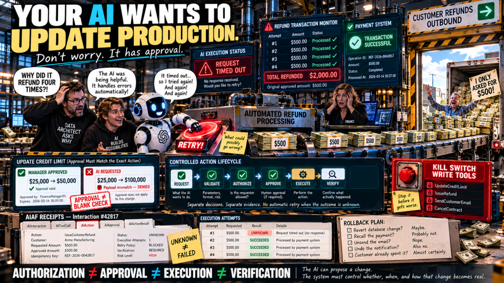

# AI Has Your Data. Now What? #10 — Your AI Wants to UPDATE Production

**Author:** Kevin Wilkie, MBA
**Published:** October 22, 2026
**Original article:** [Read on LinkedIn](https://www.linkedin.com/pulse/ai-has-your-data-now-what-10-kevin-wilkie-mba-kf6pe/)

> **Historical implementation note:** This article preserves the original educational examples. Its SQL objects and write-action patterns are illustrative, not installation scripts or a claim that all features are implemented in the current AIAF repository. For supported fresh installation, see [Getting Started](../GETTING_STARTED.md).



We've made some real progress.

Over the last nine articles, we've learned how to track prompts, classify data, validate requests, version policies, capture context, and reconstruct AI interactions.

We even took away the AI's database credentials.

In the last article, we replaced unrestricted SQL access with controlled tools.

Our fictional Sherpa of Data Accounts Receivable Assistant can now:

Search for customers.
Retrieve outstanding invoices.
Review payment history.
Check dispute status.

Each tool has a defined contract.

Each request can be validated.

Each operation can be authorized.

And AIAF keeps the receipts.

Look at us.

Responsible adults.

Then someone asks the inevitable question, "If the AI can retrieve a customer's credit limit, why can't it update it?"

Uhm...

## Reading Data Was the Easy Part

Let's revisit our fictional customer, Acme Manufacturing.

Alice, our Accounts Receivable employee, asks:

Acme Manufacturing has been a great customer. Their current credit limit is $25,000. Based on their payment history, should we increase it to $100,000?
The AI retrieves the relevant information.

Payment history looks good.

No significant overdue invoices.

No active disputes.

The AI responds:

Based on the available information, Acme Manufacturing appears to be a reasonable candidate for a credit-limit increase. I recommend reviewing an increase to $100,000.
Excellent.

The AI has helped Alice make a business decision.

But now our enthusiastic developer has an idea.

What if we add another tool?

UpdateCustomerCreditLimit

Inputs:
    CustomerId
    NewCreditLimit
Now Alice can ask, "Increase Acme Manufacturing's credit limit to $100,000."

And the AI can do it.

No more opening the ERP application.

No more navigating through screens.

No more waiting for someone to enter the change.

The demo is fantastic.

Management loves it.

And somewhere, a Data Architect develops another twitch.

Because we've crossed a boundary.

The AI is no longer just retrieving enterprise data. It's changing enterprise state.

## A Recommendation Is Not Authorization

This is our first problem.

The AI has reviewed the available information and recommended increasing the customer's credit limit.

Fine.

But who authorized the change?

Alice?

Her manager?

Finance?

The credit department?

The AI?

Please don't say the AI.

An AI model may provide useful analysis. That does not mean it has organizational authority to approve a financial decision.

We need to separate several concepts.

Recommendation: The AI believes the credit limit should increase.

Authorization: The requesting person or application has permission to initiate that type of change.

Approval: An authorized decision-maker agrees to this particular change.

Execution: The system performs the approved operation.

Verification: The system confirms what actually happened.

Those are five completely different things.

And combining them into one convenient UpdateCustomerCreditLimit() call is how we create some very interesting audit findings.

## The Model Requests. The System Decides.

Remember our architectural rule from Article #9?

The model requests capabilities. The system grants authority.

That still applies.

But with write operations, we need to go a little further.

Our workflow should look something like this:

AI Proposes Action
        |
Validate Request
        |
Authorize Requestor
        |
Evaluate Policy and Risk
        |
Human Approval (if required)
        |
Execute Controlled Action
        |
Verify Business Outcome
        |
Record Evidence
Notice that the model doesn't get to decide which steps are necessary.

The application and policy engine do.

If the action requires approval, the model cannot simply announce, "I've reviewed my own recommendation and approve it."

That's not governance.

That's a very confident rubber stamp.

## Human-in-the-Loop Is Not a Magic Checkbox

Human approval sounds wonderful.

We put a person between the AI and the dangerous operation.

Problem solved.

Except I've seen enough enterprise approval workflows to know how this can go.

An employee gets the 7,347th email of the day:

AI Action Approval Required

Customer: Acme Manufacturing
Action: Update Credit Limit

[ APPROVE ]  [ REJECT ]
They click Approve.

What exactly did they approve?
Was the existing limit $25,000 or $75,000?
What's the proposed new limit?
Why did the AI recommend the change?
Which payment records were considered?
Were there active disputes?
Was the information current?
Did the AI omit anything important?
Is the recipient actually authorized to approve a $75,000 increase?

A human clicking a button doesn't automatically make the decision informed or legitimate.

Human-in-the-loop only works when the human has enough information and authority to make the decision.

Otherwise, we've just added a button to our liability.

## Approval Must Be Bound to the Exact Action

Here's another subtle problem.

Suppose the AI proposes:

Customer: Acme Manufacturing
Current Credit Limit: $25,000
Proposed Credit Limit: $50,000
A manager approves it.

Fantastic.

But before execution, the model generates another tool request:

Customer: Acme Manufacturing
Current Credit Limit: $25,000
Proposed Credit Limit: $100,000
Can the application reuse the earlier approval?

Absolutely not.

The manager approved a specific change.

Not a general permission slip to do whatever the model thinks is appropriate afterward.

Our approval should be bound to the material details of the proposed operation.

That includes things like:

Action Type
Target Customer
Current Value
Proposed Value
Requestor
Applicable Policy
Approval Scope
Expiration

If those material details change, the approval must be reconsidered.

We can use a canonical representation and cryptographic hash to help detect changes to the proposed action.

But the hash isn't the authorization.

It's evidence that the approved payload matches the payload being executed.

And just to make things more entertaining, we also need to check whether the underlying business state has changed since approval.

If someone else already raised the customer's credit limit, we shouldn't blindly overwrite their work.

Approval is not permission to ignore concurrency.

## Not Every Write Operation Is Equally Dangerous

Let's consider a few potential AI tools.

UpdateCustomerContactPreference();
AddCustomerFollowUpNote();
SendCustomerEmail();
UpdateCustomerCreditLimit();
IssueCustomerRefund();
CancelCustomerContract();

All of these change something.

But the risk isn't the same.

Updating a contact preference is different from issuing a $25,000 refund.

Sending an email is different from modifying an internal note.

Canceling a contract may have legal and operational consequences that cannot be resolved with a database rollback.

So, our architecture needs risk-based controls.

Perhaps:

| Risk tier | Example | Typical control |
|---|---|---|
| Low | Update an internal, noncritical note | Authorized automated execution |
| Moderate | Change a customer contact preference | Validation and policy checks |
| High | Increase a credit limit | Explicit human approval |
| Critical | Issue a large refund or cancel a contract | Strong approval, additional verification, possibly separation of duties |

These are illustrative categories, not universal rules.

The organization needs to define them based on its own business processes and risk tolerance.

But the principle is straightforward:

The more consequential the action, the stronger the control should be.

## And Then the Tool Times Out

Now we get to one of my favorite failure scenarios.

Our AI has a tool - IssueCustomerRefund();

Alice requests a $500 refund.

The request is valid.

Alice is authorized.

The appropriate manager approves it.

The application sends the request to the payment system.

The payment system processes the refund.

But the network connection drops before the application receives confirmation.

The AI sees:

ERROR: Request timed out.
So what does our helpful AI do?

It retries.

The payment system processes another $500 refund.

But the response times out again.

The AI retries.

Again.

Eventually, the customer receives $2,000 in refunds.

And the AI proudly reports, "Refund completed successfully!"

Well, that customer is having a fantastic Tuesday.

Finance, somewhat less so.

## A Timeout Is Not a Failure

This is an extremely important distinction.

When an operation times out, we may not know whether the business action completed.

There are at least three possibilities:

The request never reached the payment system.
The request reached the payment system but failed.
The request succeeded, but the response never reached our application.

Those situations can look identical from the calling application's perspective.

And blindly retrying is dangerous.

This isn't a problem unique to AI.

Distributed systems have been dealing with it for decades.

But autonomous agents make it especially interesting because they can decide to retry without a human understanding the consequences.

Unknown is a legitimate execution state.

It should not automatically mean Failed.

And it definitely should not automatically mean Retry.

## Idempotency Is Not Optional for Dangerous Actions

This is where idempotency enters the picture.

An idempotent operation can be repeated without applying the same business effect multiple times.

For our refund, we might assign a unique business operation key:

RefundOperationId: REF-2026-0042817
CustomerId: 42817
Amount: $500
If the application submits the request again with the same key, the payment system should recognize that it represents the same business operation.

It should not issue a second refund.

Instead, it should return the existing result or allow us to reconcile the operation's status.

Of course, that requires the downstream system to support idempotency or for us to build a reliable enforcement mechanism around it.

Simply generating an idempotency key and logging it doesn't make the operation idempotent.

And if the payment provider doesn't support safe deduplication?

Then automatic retry may not be acceptable.

We may need to reconcile the original request before doing anything else.

This is why agentic AI needs experienced application and data engineers.

The model doesn't magically solve distributed transaction problems.

It just gives us exciting new ways to encounter them.

## Rollback Isn't Always an Option

Let's make another assumption.

Someone says, "If the AI makes a mistake, we'll just roll it back."

Perfect.

For some database operations, that's entirely reasonable.

A transaction can fail.

A transaction can roll back.

A carefully designed compensating operation can reverse certain committed changes.

But what about - SendCustomerEmail();

Can we unsend it?

What about - IssueRefund();

Can we guarantee the money hasn't already moved?

What about - CancelContract();

Can we undo the notification, downstream integrations, and business consequences?

Or - SubmitPurchaseOrder();

after the supplier has already shipped the product?

Not every business action is reversible.

And even when a compensating action exists, it isn't necessarily equivalent to the original action never happening.

Rollback is a database concept. Business consequences are considerably less cooperative.

That's why write tools need to understand reversibility and side effects before execution.

## Building AIAF: AIAction

Our AIAF framework has been collecting interaction evidence.

Now we need to record proposed business actions.

Let's add a new table.

```sql
CREATE TABLE aiaf.AIAction
(
    AIActionId bigint IDENTITY(1,1) NOT NULL
        CONSTRAINT PK_AIAction PRIMARY KEY,

    InteractionId bigint NOT NULL,
    AIToolCallId bigint NULL,
    ActionType varchar(100) NOT NULL,
    TargetSystem nvarchar(200) NOT NULL,
    TargetIdentifier nvarchar(500) NOT NULL,
    RiskLevel varchar(30) NOT NULL,
    ActionPayloadHash varbinary(32) NOT NULL,
    IdempotencyKey varchar(200) NOT NULL,
    ActionStatus varchar(30) NOT NULL
        CONSTRAINT DF_AIAction_Status
        DEFAULT ('REQUESTED'),

    RequestedAt datetime2(3) NOT NULL
        CONSTRAINT DF_AIAction_RequestedAt
        DEFAULT (SYSUTCDATETIME()),

    CONSTRAINT FK_AIAction_AIInteraction
        FOREIGN KEY (InteractionId)
        REFERENCES aiaf.AIInteraction (InteractionId),

    CONSTRAINT FK_AIAction_AIToolCall
        FOREIGN KEY (AIToolCallId)
        REFERENCES aiaf.AIToolCall (AIToolCallId),

    CONSTRAINT UQ_AIAction_IdempotencyKey
        UNIQUE (IdempotencyKey),

    CONSTRAINT CK_AIAction_Status
        CHECK (ActionStatus IN
        (   'REQUESTED',
            'VALIDATED',
            'AUTHORIZED',
            'PENDING_APPROVAL',
            'APPROVED',
            'REJECTED',
            'DENIED',
            'EXECUTING',
            'SUCCEEDED',
            'FAILED',
            'UNKNOWN',
            'CANCELLED'        ))
);
```

Notice what we're not storing.

The complete raw action payload.

That may contain sensitive customer information, financial details, or other restricted data.

Article #3 is still watching us.

Instead, we store a hash of the canonical action payload.

The actual proposed change needs to be available through an appropriately secured workflow, but it doesn't necessarily belong as unrestricted text in our audit tables.

Also, ActionStatus is a useful current-state indicator, not a complete historical record of every state transition. We'll need immutable or tamper-evident transition evidence as this framework matures.

And a database uniqueness constraint on IdempotencyKey only protects the AIAF record. It does not, by itself, prevent duplicate execution in an external payment system.

## Building AIAF: AIApproval

Now we need to capture approvals.

```sql
CREATE TABLE aiaf.AIApproval
(
    AIApprovalId bigint IDENTITY(1,1) NOT NULL
        CONSTRAINT PK_AIApproval PRIMARY KEY,

    AIActionId bigint NOT NULL,
    ApproverIdentifier nvarchar(256) NOT NULL,
    ApprovalDecision varchar(30) NOT NULL,
    ApprovedPayloadHash varbinary(32) NOT NULL,

    DecisionAt datetime2(3) NOT NULL
        CONSTRAINT DF_AIApproval_DecisionAt
        DEFAULT (SYSUTCDATETIME()),

    ExpiresAt datetime2(3) NULL,
    DecisionReason nvarchar(1000) NULL,

    CONSTRAINT FK_AIApproval_AIAction
        FOREIGN KEY (AIActionId)
        REFERENCES aiaf.AIAction (AIActionId),

    CONSTRAINT CK_AIApproval_Decision
        CHECK (ApprovalDecision IN
        (   'APPROVED',
            'REJECTED'        ))
);
```

Now we can establish:

Action: 8912
Customer: Acme Manufacturing

Proposed Change:
Credit Limit $25,000 → $100,000

Approver:
FinanceManager01

Decision:
APPROVED

Payload Hash:
MATCH
Of course, a matching hash is only one part of the decision.

Before execution, we still need to confirm that the approval is valid, hasn't expired, was issued by someone with the required authority, and applies to the current business state.

For high-risk operations, we may also require multiple approvers or separation of duties.

An employee shouldn't necessarily be able to request, approve, and execute their own $100,000 credit-limit increase.

Even if they ask the AI very politely.

## Building AIAF: AIActionResult

Finally, we need to know what actually happened.

```sql
CREATE TABLE aiaf.AIActionResult
(
    AIActionResultId bigint IDENTITY(1,1) NOT NULL
        CONSTRAINT PK_AIActionResult PRIMARY KEY,

    AIActionId bigint NOT NULL,
    ExecutionAttempt int NOT NULL,
    StartedAt datetime2(3) NOT NULL,
    CompletedAt datetime2(3) NULL,
    ExecutionStatus varchar(30) NOT NULL,
    ExternalOperationId nvarchar(200) NULL,
    VerificationStatus varchar(30) NULL,
    VerifiedAt datetime2(3) NULL,
    ErrorCode nvarchar(100) NULL,
    SanitizedErrorMessage nvarchar(2000) NULL,

    CONSTRAINT FK_AIActionResult_AIAction
        FOREIGN KEY (AIActionId)
        REFERENCES aiaf.AIAction (AIActionId),

    CONSTRAINT UQ_AIActionResult_Attempt
        UNIQUE (AIActionId, ExecutionAttempt),

    CONSTRAINT CK_AIActionResult_Status
        CHECK (ExecutionStatus IN
        (   'SUCCEEDED',
            'FAILED',
            'UNKNOWN'        ))
);
```

This is important because an action may have more than one execution attempt.

And an execution attempt may have an uncertain outcome.

For example:

AIActionId: 8912

Attempt 1
---------
Status: UNKNOWN
Reason: Network timeout
External Operation: REF-2026-0042817

Attempt 2
---------
Not executed
Reason: Original operation awaiting reconciliation
That's much better than:

ERROR
RETRY
ERROR
RETRY
SUCCESS
Especially when we're moving money.

## The State Machine Matters

We now have an action lifecycle.

But it's not enough to define a list of statuses.

We need to control which transitions are allowed.

For example:

REQUESTED
    |
VALIDATED
    |
AUTHORIZED
    |
PENDING_APPROVAL
    |
APPROVED
    |
EXECUTING
    |
    +----> SUCCEEDED
    |
    +----> FAILED
    |
    +----> UNKNOWN
A denied action should not somehow transition into execution.

A rejected action should not become approved because the model tried again.

An expired approval should not remain valid indefinitely.

And a completed action should not execute again merely because the application restarted.

These transitions need to be enforced by the application and persistence layer, not simply described in a prompt.

Otherwise, the model might find a very creative shortcut.

And we already know how much fun that can be.

## We Need a Kill Switch

Let's say our AR Assistant has been running successfully for months.

Then someone deploys a new system prompt.

Or a tool definition changes.

Or a malicious document gets retrieved.

Or the model starts behaving unexpectedly.

Suddenly, the AI begins requesting credit-limit increases for hundreds of customers.

Every request might be syntactically valid.

Every customer might exist.

But the overall behavior is clearly abnormal.

What happens?

Can we disable UpdateCustomerCreditLimit immediately?
Can we stop all write tools while leaving read-only tools available?
Can we suspend a particular agent?
Can we revoke its execution identity?
Can we stop queued operations that haven't executed?
Can we prevent in-flight retries?

We should be able to.

A kill switch isn't necessarily a single red button.

It may involve feature flags, authorization policy, tool availability, credential revocation, queue controls, and operational procedures.

But the requirement is simple:

When an AI system starts behaving dangerously, we need a reliable way to stop it from causing additional damage.
And we need to test that mechanism before the emergency.

A kill switch that exists only in the architecture diagram is not especially comforting.

## Monitoring the Actions

Now that AIAF records proposed and executed actions, we can ask some interesting questions.

Which AI applications are requesting production writes?
Which tools generate the most denied actions?
How many credit-limit changes required human approval?
How often do approvers reject AI recommendations?
Which actions have been waiting for approval for more than 24 hours?
Which actions have an UNKNOWN execution status?
How many retries occurred?
Are any agents repeatedly requesting actions outside their authorization?
Are certain model versions associated with higher rejection rates?
Are the business outcomes matching what the AI intended to accomplish?

Because a successful tool execution doesn't necessarily mean the business result was correct.

The API can return HTTP 200.

The stored procedure can complete.

The transaction can commit.

And the wrong customer can still have their credit limit increased.

Technical success and business correctness are not the same thing.

## AIAF Is Not the Workflow Engine

Here's an important architectural distinction.

We're adding AIAction, AIApproval, and AIActionResult to AIAF.

That doesn't mean AIAF should become the system that executes every business action.

The existing ERP, CRM, payment platform, or workflow engine may already have perfectly good approval and execution controls.

We should use them.

AIAF's responsibility is to preserve the interaction evidence and correlate the decisions.

For example:

AIAF Interaction 42817
        |
AI Action 8912
        |
Approval Workflow 17382
        |
ERP Credit Limit Change 77219
        |
Verified Outcome
The business system remains authoritative for its transaction.

AIAF records how the AI interaction caused or participated in that transaction.

We don't need to rebuild the entire enterprise inside our audit framework.

We've got enough work already.

## What Does Our Receipt Look Like Now?

Our AIAF evidence folder is becoming a full-time employee.

For Interaction 42817, we might have:

INTERACTION 42817
|
|-- Requestor: Alice
|-- Application: AR Assistant
|-- Prompt: FIN-AR-004 v3
|-- Model: Ollama / llama3.1:8b
|-- Context: Customer + Payment History
|-- Policy: FIN-AI-004 v2
|
|-- TOOL CALL
|   |-- UpdateCustomerCreditLimit v1
|   |-- Validation: PASS
|   |-- Authorization: ALLOW
|
|-- ACTION 8912
|   |-- Customer: Acme Manufacturing
|   |-- Current Limit: $25,000
|   |-- Proposed Limit: $100,000
|   |-- Risk: HIGH
|   |-- Status: SUCCEEDED
|
|-- APPROVAL
|   |-- Approver: FinanceManager01
|   |-- Decision: APPROVED
|   |-- Approved Payload: MATCH
|
|-- EXECUTION
|   |-- Attempt: 1
|   |-- External Operation: 77219
|   |-- Status: SUCCEEDED
|
|-- VERIFICATION
    |-- Customer Credit Limit: $100,000
    |-- Result: VERIFIED
That's a considerably better answer to "Who changed Acme's credit limit?" than, "The AI did."

And if something goes wrong, we have somewhere to begin the investigation.

## The Real Problem Isn't That AI Can Make Changes

I don't think we should pretend that AI performing business actions is inherently a bad idea.

There are legitimate opportunities here.

AI can help initiate routine workflows.

It can reduce repetitive manual work.

It can identify problems and recommend corrective actions.

It can coordinate across systems.

It may even safely execute certain low-risk operations without human involvement.

But the surrounding architecture needs to account for something fundamental.

The model can be wrong.

It can misunderstand a request.

It can retrieve incomplete context.

It can request the wrong tool.

It can select the wrong customer.

It can misinterpret a result.

It can retry an operation that already succeeded.

And it can be manipulated by malicious instructions embedded in data.

We shouldn't design as though none of those things will happen.

We should design so that when they do, the consequences are controlled.

## The Difference Between a Chatbot and an Agent

A chatbot might give Alice a bad recommendation.

That's a problem.

But Alice still has to decide what to do with it.

An agent with write capabilities can turn that bad recommendation into a business transaction.

That's a much bigger problem.

The difference isn't simply that one system is more intelligent.

It's that one system has been granted authority to affect the real world.

And authority requires boundaries.

It requires accountability.

It requires approval where appropriate.

It requires verification.

And it requires evidence.

That's what we're building.

## Keep the Action Receipts

We've now extended AIAF beyond observing what the AI saw and said.

We're beginning to capture what the AI attempted to do, what the surrounding systems permitted, and what actually happened.

That's a major step.

But now we have another uncomfortable question.

Suppose our AI makes a bad change.

A customer gets an unauthorized credit-limit increase.

Someone investigates.

We pull the AIAF records.

And everything looks perfectly legitimate.

The request was authorized.

The approval was recorded.

The execution succeeded.

The audit trail says nothing bad happened.

Wonderful.

Except someone with elevated access modified the audit records afterward.

How would we know?

We've spent ten articles collecting receipts.

Now we need to ask whether those receipts can be trusted.

Next time: Your AI Audit Log Says Nothing Bad Happened. Can You Prove It?

Because an audit trail that can be quietly rewritten is just another database table.

And we've spent far too much time building this thing to let someone change the ending.
