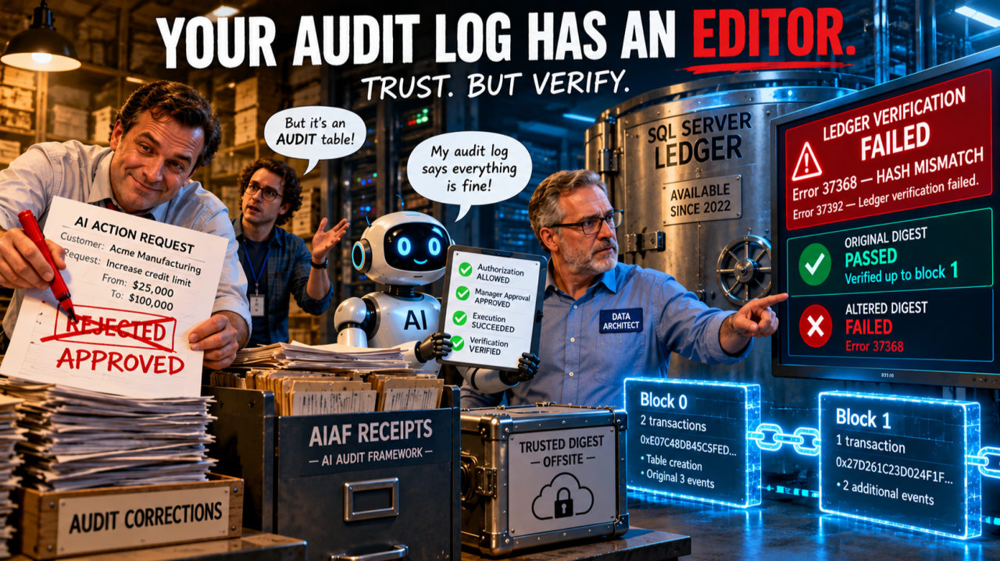

# Your AI Audit Log Says Nothing Bad Happened. Can You Prove It?

**AI Has Your Data. Now What? — Part 11**
**Author:** Kevin Wilkie, MBA
**Published:** October 29, 2026
**Original article:** [LinkedIn](https://www.linkedin.com/pulse/your-ai-audit-log-says-nothing-bad-happened-can-you-kevin-wilkie-mba-v8lde/)

> **Historical implementation note:** This article documents the original SQL Server 2022 ledger experiment and the architecture as it evolved. Examples are educational, not a replacement for the current [Getting Started](../GETTING_STARTED.md) installation guide.



We've spent ten articles building an AI audit framework.

We've captured prompts, tracked model versions, recorded retrieved context, enforced policies, controlled database access, and added approval workflows for actions that could change production data.

We've even learned what happens when an AI decides that a $500 refund deserves four attempts.

Our AI Interaction Audit Framework (AIAF) is collecting receipts faster than Finance can request another filing cabinet.

Everything is going beautifully.

Until someone asks:

"How do we know nobody changed the audit records?"

So, that's a rather important question.


## Congratulations. Your Audit Log Now Has an Editor.

Remember Acme Manufacturing?

Our AI assistant wanted to increase its credit limit from $25,000 to $100,000.

We built controls to make sure that couldn't happen without authorization and approval.

Six months later, Finance discovers the credit limit was increased.

Naturally, we check the audit records.

Everything looks as it should.

Interaction: 42817
Action: UpdateCustomerCreditLimit
Customer: Acme Manufacturing

Authorization: ALLOWED
Manager Approval: APPROVED
Execution: SUCCEEDED
Verification: VERIFIED
Wonderful!

Except the Finance Manager insists they rejected the request.

And now we have a problem.

Did the manager forget approving it?

Did the AI bypass the approval process?

Did someone manually change the credit limit?

Or did somebody change the audit records afterward?

That last possibility deserves considerably more attention than it usually receives.

Because an ordinary audit table is still just a table.

Someone with sufficient permissions can modify its contents.

Maybe a developer was troubleshooting.

Maybe an administrator was correcting what they believed was bad data.

Maybe a service account was compromised.

Or perhaps someone decided the audit dashboard would look much better if that rejection became an approval.

Sadly, I've worked with databases long enough to know that last possibility isn't particularly far-fetched.

An audit log tells us what is recorded. It doesn't automatically prove that the records haven't changed.


## But We Made the Table INSERT-Only!

Excellent.

That's a good start.

Maybe we revoked UPDATE and DELETE permissions from the application account.

Maybe we created a trigger to prevent modifications.

Maybe we even told everyone that audit records must never be changed.

But what happens when someone with elevated permissions needs to "fix" something?

What happens if a privileged account is compromised?

What happens if someone bypasses the application entirely?

The problem isn't necessarily that our audit logging was poorly designed.

The problem is that preventing ordinary changes and proving historical integrity are two very different requirements.

Temporal tables can help preserve row history.

Change Data Capture can help identify changes.

Triggers can record activity.

All useful capabilities.

But none automatically establishes an independently verifiable cryptographic history against an attacker who controls the underlying evidence.

We need something stronger.


## SHA-256 Enters the Conversation

One approach is to calculate a cryptographic hash for every audit record.

SQL Server makes that straightforward.


```sql
SELECT HASHBYTES
(
    'SHA2_256',
    CONVERT
    (
        varbinary(max),
        N'Interaction 42817|Approval REJECTED'
    )
) AS AuditHash;
```

SHA-256 produces a 256-bit hash.

Change the input, and the resulting hash will almost certainly change.

And despite occasional confusion about how quickly computers can calculate hashes, SHA-256 itself has not been practically broken. It remains appropriate for this kind of integrity verification.

But hashing introduces another question.

Where do we store the hash?

Suppose we store it right next to the audit record.

Someone changes the approval from REJECTED to APPROVED.

Then they calculate a new hash.

Everything matches again.

The hashing algorithm worked perfectly.

Our security architecture didn't.

We could build a hash chain, where each record incorporates the hash of the previous record.

That makes changing historical records more difficult to conceal.

But someone who controls the entire chain could potentially recalculate it and replace the reference we use to verify it.

A cryptographic hash is only as trustworthy as the reference we're comparing it against.

We need a trusted checkpoint that someone controlling the database cannot silently replace.

And this brings us to a SQL Server feature I suspect many people still haven't explored.


## Wait. SQL Server Has Ledger Tables?

Yes.

And here's something worth emphasizing.

Ledger tables have been available since SQL Server 2022.

Not SQL Server 2025.

Not some experimental feature that appeared last week.

SQL Server 2022.

They've been sitting there for a few years, although I suspect plenty of organizations still haven't had a reason to investigate them.

Ledger tables provide cryptographic tamper-evidence for database history.

SQL Server supports two primary types.

Updatable ledger tables allow updates and deletes while preserving protected historical versions.

Append-only ledger tables allow inserts but prohibit normal updates and deletes.

Both use SQL Server's database ledger infrastructure to support cryptographic verification.

For AIAF, append-only ledger tables are particularly interesting.

If an approval was rejected, we don't want someone silently changing that historical event into an approval.

If the decision legitimately changes, we want another event explaining what happened.

History should not disappear simply because someone dislikes the ending.

So rather than just describing ledger tables, I decided to test them.

On SQL Server 2022.

Because apparently, a feature that's been available since 2022 deserves to be used at least once before we write about it.


## Building AIAF: Let's Create a Ledger Table

For the experiment, I created an isolated schema in a development database.

The table is intentionally simple. We're interested in verifying ledger behavior, not rebuilding the entire framework in one article.


```sql
CREATE SCHEMA aiaf_lab;
GO
```


```sql
CREATE TABLE aiaf_lab.AIAuditEvent
(    AIAuditEventId bigint IDENTITY(1,1)
        NOT NULL PRIMARY KEY,

    InteractionId bigint NOT NULL,
    EventType varchar(100) NOT NULL,
    EntityType varchar(100) NOT NULL,
    EntityId bigint NOT NULL,
    EventDescription nvarchar(1000) NOT NULL,
    RecordedAt datetime2(3) NOT NULL
        DEFAULT SYSUTCDATETIME()      )
WITH
(    LEDGER = ON (APPEND_ONLY = ON)   );
```

Notice two things.

First, we're still using bigint IDENTITY for AIAF's internal identifiers.

Second, we haven't written any custom hash-chain logic.

SQL Server handles the ledger infrastructure.

It also automatically creates hidden columns to track the transaction and sequence associated with each inserted row.

In our experiment, SQL Server added:

`ledger_start_transaction_id`
`ledger_start_sequence_number`

It also created a new ledger view:

`aiaf_lab.AIAuditEvent_Ledger`

So far, so good.

Now let's give our fictional Finance Manager something to complain about.


## The Approval That Never Happened

We inserted three events into our audit table.


```sql
INSERT INTO aiaf_lab.AIAuditEvent
(
    InteractionId,
    EventType,
    EntityType,
    EntityId,
    EventDescription
)
VALUES
(    42817,
    'ACTION_REQUESTED',
    'AIAction',
    8912,
    'Increase credit limit from $25,000 to $100,000'),
(    42817,
    'AUTHORIZATION_ALLOWED',
    'AIAction',
    8912,
    'Requestor authorized to initiate change'),
(    42817,
    'APPROVAL_REJECTED',
    'AIApproval',
    17382,
    'Finance Manager rejected the increase');
```

Three events.

One SQL statement.

When we inspected the ledger metadata, we found something interesting.

*Ledger transaction metadata from the original experiment.*
All three rows belonged to the same ledger transaction.

Their sequence numbers distinguished the operations within that transaction.

Now let's imagine somebody decides that rejected approval was inconvenient.


```sql
UPDATE aiaf_lab.AIAuditEvent
SET EventType = 'APPROVAL_APPROVED'
WHERE InteractionId = 42817
  AND EventType = 'APPROVAL_REJECTED';
```

SQL Server responded:


```text
Msg 37359
```


Updates are not allowed for the append only
Ledger table 'aiaf_lab.AIAuditEvent'.
Beautiful.

What about deleting the rejection?


```sql
DELETE FROM aiaf_lab.AIAuditEvent
WHERE InteractionId = 42817
  AND EventType = 'APPROVAL_REJECTED';
```

Same error.

Interestingly, SQL Server complained that updates weren't allowed even though I issued a DELETE.

Apparently, deleting history is just an especially aggressive update.

Either way, the records survived.

But we're not finished.

Because preventing an UPDATE doesn't prove that someone with deeper access couldn't tamper with the underlying database history.

For that, we need the cryptographic part.


## The Digest Needs to Leave the Building

SQL Server ledger uses SHA-256-based cryptographic structures to link transactions into ledger blocks.

We can generate a database ledger digest using:


```sql
EXEC sys.sp_generate_database_ledger_digest;
```

This closes the current ledger block and returns a JSON digest representing the ledger's state at that checkpoint.

In our experiment, SQL Server generated a digest for block 0.

That block contained two transactions: one associated with creating our ledger table and another containing our three audit events.

The digest included the database name, block ID, block hash, and timestamps.

Now comes the important architectural decision.

The digest must be preserved somewhere outside the control of whoever could compromise the database.

If we store the only trusted digest in the same database, under the same administrative control, an attacker may be able to replace both the evidence and the reference used to verify it.

That's not independent verification.

That's asking the suspect to certify their own alibi.

For our lab, we saved the digest separately.

In a production architecture, we'd use independently controlled, appropriately immutable storage, with access restrictions and retention requirements that reflect the sensitivity of the evidence.

Then we can ask SQL Server to verify its history against that saved reference.


## Trust, But Verify. Literally.

Before running verification, we enabled snapshot isolation in our development database:


```sql
ALTER DATABASE [YourLabDatabase]
SET ALLOW_SNAPSHOT_ISOLATION ON;
```

This is distinct from enabling Read Committed Snapshot Isolation. We didn't change the database's default READ COMMITTED behavior.

Then we ran verification using the previously saved digest.


```sql
DECLARE @Digest nvarchar(max) = N'<saved digest JSON>';

EXEC sys.sp_verify_database_ledger    @digests = @Digest;
```

And SQL Server responded:


```text
last_verified_block_id
----------------------
0

Ledger verification successfully verified up to block 0.
```

Success!

But I wanted to know whether it was actually checking anything.

So we changed one hexadecimal character in a copy of the saved digest.

Just one.

We didn't modify the database.

We didn't touch the ledger table.

We simply supplied an incorrect reference hash.

SQL Server responded:


```text
Msg 37368
```


The hash of block 0 in the database ledger does not match the hash provided in the digest for this block.


```text
Msg 37392
```


Ledger verification failed.
Now we're getting somewhere.

The original digest passed.

The altered digest failed.

We had demonstrated that SQL Server could detect a cryptographic mismatch between its ledger history and the supplied reference.

That doesn't prove somebody tampered with the database. In this case, we deliberately changed the digest.

But it demonstrates the mechanism we'd use to detect an inconsistency.

An audit record says what happened. A trusted digest helps us determine whether the protected history still matches what was recorded at the checkpoint.


## Your Verification Passed. Wonderful. What Did It Verify?

This next experiment is my favorite part.

After generating our first digest, we inserted two more audit events.

A customer requested a $500 refund.

The request was denied because the necessary approval was missing.

We now had five events in our table.

The new events belonged to transaction 4294359075, which occurred after our original digest was generated.

Then we verified the database again.

Using the original digest.

And SQL Server happily reported:

Ledger verification successfully verified up to block 0.
Wait a minute.

We have five events now.

Why did verification still pass?

Because the original digest was valid for the history through block 0.

It wasn't a checkpoint for the newer transaction.

A successful verification doesn't necessarily mean all current activity has been verified.

That's an important distinction.

We could proudly display a green checkmark on our monitoring dashboard while newer audit activity remained outside the latest independently anchored checkpoint.

So we generated a second digest.

This time, SQL Server finalized block 1.

When we inspected the ledger blocks, we found that block 1's previous_block_hash matched the digest hash we'd saved for block 0.

Exactly.

That's the cryptographic linkage in action.

And when we verified against our second digest, SQL Server responded:

Ledger verification successfully verified up to block 1.
Now we had verified the extended history through the newer checkpoint.

There's an operational lesson here that goes beyond the SQL syntax.

How often should we generate and independently preserve digests?

Every hour?

Every fifteen minutes?

After particularly consequential actions?

That depends on the risk, performance requirements, and how much unanchored activity the organization is willing to tolerate.

But it needs to be an intentional decision.

Otherwise, someone will eventually show us a successful verification result that covers yesterday's history while today's most important transactions remain outside the checkpoint.

Your audit verification passed. Wonderful. Now tell me what it actually verified.


## Tamper-Evident Doesn't Mean Tamper-Proof

There's a distinction I want to make before anyone starts treating ledger tables like a universal security solution.

Ledger doesn't prevent every possible attack.

It doesn't prevent an authorized process from inserting a false event.

It doesn't prove that a Finance Manager actually clicked APPROVE.

It doesn't guarantee that every important interaction was logged.

And it doesn't automatically protect detailed evidence stored elsewhere merely because a ledger event references that evidence.

If our ledger records that approval 17382 existed, but the original approval details can be silently changed in another table, we still have an evidence-integrity problem.

The design needs to protect the actual facts we're relying on, whether through ledger-protected records, cryptographic commitments to canonical evidence, independently preserved copies, or other appropriate controls.

Ledger also doesn't eliminate the need for least privilege, separation of duties, monitoring, backups, or incident response.

And the independent digest really does need to be independent.

A local text file was fine for our demonstration.

It is not my proposed enterprise security architecture.

Ledger provides tamper-evidence. It does not magically establish the truth of everything that was originally recorded.


## What About Snowflake?

We're demonstrating this using SQL Server because it provides a native ledger capability.

But AIAF isn't supposed to be a SQL Server-only solution.

The framework's security requirements should survive a change in database platform.

Snowflake, for example, provides Query History and Access History capabilities that help investigate database activity.

Those are valuable.

But query history is not automatically the same thing as a cryptographically verifiable, independently anchored ledger.

If we implement AIAF using Snowflake, we still need to decide how audit evidence will be protected, how integrity will be verified, and where trusted checkpoints will be preserved.

That might involve an independently protected event stream, cryptographic hashes, signed checkpoints, immutable external storage, or a combination of controls.

The exact implementation will vary by platform.

The architectural requirement doesn't.

We need to be able to challenge the integrity of our evidence without relying entirely on the system that produced it.

And yes, technically, somebody could probably propose building the entire AI audit framework in Microsoft Access.

We could also put the receipts in a shoebox under someone's desk.

Neither would be my first architectural recommendation.


## Building AIAF: What Changes Now?

We're adding aiaf.AIAuditEvent as a tamper-evident event stream in our SQL Server reference implementation.

It will correlate important activity from the components we've built throughout this series.

Prompt execution.
Validation and authorization decisions.
Retrieved context.
Tool requests.
Approvals.
Business actions.
Execution outcomes.
Verification results.

The detailed operational tables still matter. We aren't replacing the entire framework with one giant ledger table.

But we are establishing a protected history of consequential events and identifying where detailed evidence needs its own integrity guarantees.

We also need a process for generating digests, storing them independently, verifying ledger history, and responding to failures.

A verification failure should not quietly disappear into the same logging system we're trying to verify.

It needs independent alerting and investigation.

And we should distinguish between a hash mismatch, a missing digest, and a verification job that never ran.

Those are different failures.

They may have different causes.

But none should be ignored.

Finally, we need to measure how current our verification coverage actually is.

A green checkmark without a verified-through checkpoint is not particularly informative.


## Keep the Receipts. Verify the Receipts.

We've spent decades securing databases.

Then we connected AI to enterprise data.

We discovered that prompts are data.

That retrieved context matters.

That model outputs aren't necessarily reproducible.

That read-only access isn't automatically safe.

That tools need authorization.

And that allowing AI to change production requires controls far beyond a friendly approval button.

Now we've reached another uncomfortable realization.

An audit log is a claim. Tamper-evident evidence gives us a way to challenge that claim.

Our SQL Server 2022 experiment demonstrated that we could prevent ordinary changes to append-only ledger records, detect mismatched digests, and verify cryptographically linked history through specific checkpoints.

It also reminded us that the integrity of our evidence depends on protecting the references we use to verify it.

Because if someone can rewrite both the audit trail and the evidence used to validate it, we haven't built much of a defense.

We've just created a more elaborate filing cabinet.

So, when Finance asks who increased Acme Manufacturing's credit limit, I want more than a row that says APPROVED.

I want to know who requested the action.

Who authorized it.

Who approved it.

What actually executed.

What the business system recorded.

And whether the evidence supporting those answers is still intact.

Keep those receipts.

And verify the receipts.


## Next Time: Who Watches the AI Watching the AI?

We've built an audit trail.

We've added integrity verification.

But who's watching for suspicious behavior?

Who's noticing when denied tool requests suddenly increase?

When approval failures spike?

When an agent starts requesting capabilities it never needed before?

Or when the audit pipeline itself stops recording events?

Because an audit trail that no one monitors is an excellent resource for the investigation that happens three weeks after the damage.

And I'd rather find out a bit sooner than that.
