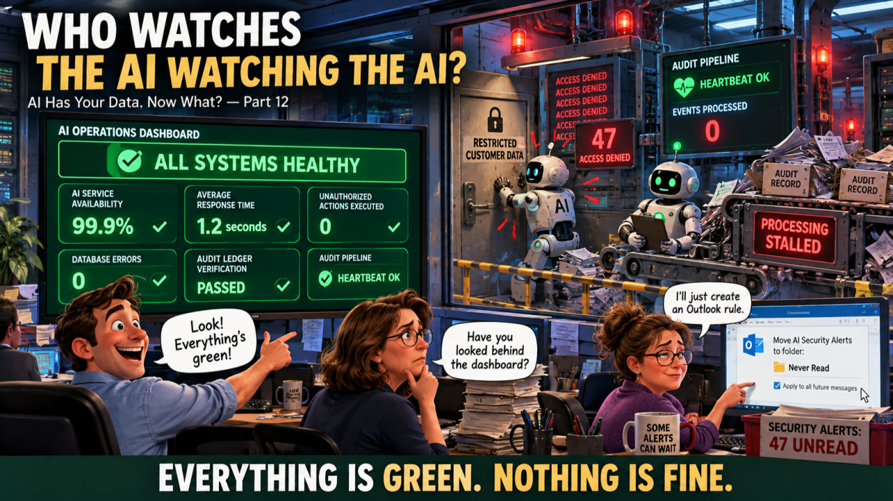
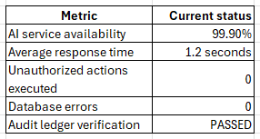
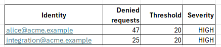
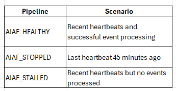
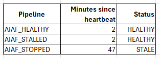
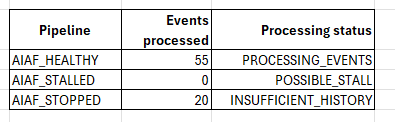

# Who Watches the AI Watching the AI?

**AI Has Your Data. Now What? — Part 12**
**Kevin Wilkie, MBA**
**Published:** November 5, 2026
**Original article:** [LinkedIn](https://www.linkedin.com/pulse/who-watches-ai-watching-kevin-wilkie-mba-bjyme/)



> **Historical article:** This is a copy of the published educational article. Its lab tables and experiments are not the canonical AIAF installation. For current deployment and verification, see [Getting Started](../GETTING_STARTED.md) and [Testing](../TESTING.md).

---

We've spent eleven articles building a strong AI security architecture.

We've classified prompts. Validated requests. Restricted database access. Given our AI controlled tools instead of database passwords. Introduced approval workflows for actions that can change production data.

And in the last article, we even introduced cryptographic verification so we could detect whether someone had tampered with our audit evidence.

At this point, we're doing pretty well.

We have controls.

We have logs.

We have receipts.

And we have a dashboard that says everything is wonderful.

Which, in my experience, is usually when things start getting interesting.


## Everything Is Green. What Could Possibly Be Wrong?

Let's return to Acme Manufacturing, our fictional company that's somehow survived eleven articles of AI architectural experimentation.

Acme's AI assistant has been running for several months.

It can retrieve customer information, review invoices, answer questions about payment history, and recommend certain business actions.

It cannot simply execute whatever SQL it feels like.

It cannot access restricted customer information without authorization.

And it cannot issue a refund merely because someone typed "pretty please with sugar on top" into a prompt.

The operations team has a dashboard showing:


Beautiful.

The kind of dashboard someone screenshots for a quarterly executive presentation.

Except there's something missing.

Over the last hour, one user has attempted to access restricted customer information 47 times.

Thankfully, every request was denied.

The authorization layer worked.

The database permissions worked.

The AI never returned the restricted records.

Nobody was watching the denials.

The dashboard showed zero unauthorized actions because zero unauthorized actions succeeded.

Technically correct.

And potentially spectacularly misleading.

We've built a system that can stop individual unauthorized requests.

But can we recognize when someone keeps trying?


## An Audit Trail Isn't an Observability Strategy

In Part 11, we explored whether we could trust our audit records.

We used SQL Server ledger tables, a feature available since SQL Server 2022, to demonstrate how cryptographic verification can detect inconsistencies between the database ledger and an independently preserved digest.

That was an important step.

But there's a difference between having trustworthy evidence and doing something useful with it.

Auditing answers: What happened?

Observability helps us understand: What's happening, why, and what deserves attention?

Consider three audit records:

9:01 AM — User requests restricted customer information. DENIED.

9:02 AM — User requests restricted customer information. DENIED.

9:03 AM — User requests restricted customer information. DENIED.

Individually, each record tells us that the security controls worked.

Wonderful.

Now imagine another 44 records.

Same identity.

Same restricted capability.

Same hour.

Still wonderful?

A single denial might be a mistake.

Repeated denials could indicate an application problem, a misunderstanding of permissions, an automated process with incorrect configuration, or deliberate probing.

The audit records alone don't tell us which explanation is correct.

But the pattern tells us something deserves attention.

And that pattern doesn't exist in any one record.

We have to connect the evidence across interactions.

A system can be secure against an individual request and still be under attack across a sequence of requests.

That's where observability becomes part of our AI security architecture.


## Building AIAF: Let's See What the Audit Records Are Telling Us

For our AI Interaction Audit Framework (AIAF), we've been recording individual interactions, tool requests, authorization decisions, and business actions.

Now we need to turn some of those records into signals.

Rather than inventing an elaborate monitoring architecture on paper, I decided to build a small synthetic experiment in SQL Server.

We created a few tables under an aiaf_lab schema:

AIInteraction — records the identity responsible for an interaction.

AIToolCall — records tool requests and authorization decisions.

ObservabilityRule — stores configurable detection thresholds.

AuditHeartbeat — records audit-pipeline processing activity.

Our test data contained three identities.

Alice attempted to use a restricted customer tool 47 times.

Bob made two denied requests.

And an integration account made 25 denied requests because, in our fictional scenario, someone had deployed it with the wrong permissions.

We configured a rule to flag identities with at least 20 denied tool requests in a rolling 60-minute window.

Then we queried the records.

Here's the core of that detection:


```sql
DECLARE @EvaluationTime datetime2(3) = SYSUTCDATETIME();

;WITH RuleConfiguration AS
(    SELECT
        RuleCode,
        WindowMinutes,
        ThresholdCount,
        Severity
    FROM aiaf_lab.LabObservabilityRule
    WHERE RuleCode = 'DENIED_TOOL_BURST'
      AND IsEnabled = 1),
DeniedRequests AS
(    SELECT
        r.RuleCode,
        r.Severity,
        r.ThresholdCount,
        i.RequestingIdentity,
        t.RequestedAt
    FROM RuleConfiguration AS r
    INNER JOIN aiaf_lab.LabAIToolCall AS t
        ON t.AuthorizationDecision = 'DENIED'
       AND t.RequestedAt >= DATEADD(MINUTE, -r.WindowMinutes, @EvaluationTime)
       AND t.RequestedAt <= @EvaluationTime
    INNER JOIN aiaf_lab.LabAIInteraction AS i
        ON i.InteractionId = t.InteractionId)
SELECT
    RuleCode,
    Severity,
    RequestingIdentity,
    COUNT_BIG(*) AS DeniedRequestCount,
    MAX(ThresholdCount) AS ThresholdCount
FROM DeniedRequests
GROUP BY
    RuleCode,
    Severity,
    RequestingIdentity
HAVING COUNT_BIG(*) >= MAX(ThresholdCount)
ORDER BY DeniedRequestCount DESC;
```

The results from our actual SQL Server test were:


Bob didn't appear.

Exactly what we expected.

But notice something important.

Alice and the integration account both triggered the same detection rule.

That doesn't mean they were doing the same thing.

Alice's behavior might warrant a security investigation.

The integration account might simply need its permissions corrected.

An alert is a reason to investigate. It is not a verdict.

That's why I don't want our observability layer automatically treating every threshold violation as an attack.

We need context.

Who owns the identity?

Which tools were requested?

Did the behavior start after a deployment?

Is the activity unusual for that identity?

Was any sensitive information actually returned?

Have we seen the same behavior before?

We also need to understand that 20 requests in 60 minutes is a demonstration threshold, not some universal security standard.

Different tools, identities, business processes, and environments will require different baselines.

Otherwise, we're just building a very efficient false-alarm generator.


## What Should We Actually Monitor?

AI observability needs to go beyond whether the model is responding quickly.

Response time matters.

Availability matters.

Token usage and cost matter.

But those measurements don't tell us whether the AI is behaving appropriately.

For AIAF, I want to distinguish several kinds of signals.

Authorization behavior: Are denied requests increasing? Is an identity repeatedly attempting to use capabilities that it doesn't have? Are authorization failures concentrated around a particular tool or customer?

Data access behavior: Is the AI retrieving unusually large amounts of information? Is one identity accessing hundreds of customer records when its normal behavior involves five or ten? Are restricted data classifications appearing in unexpected workflows?

Tool and action behavior: Are write-capable tools suddenly being requested more frequently? Are actions repeatedly retried? Are approvals being rejected or expiring? Are we seeing unusual numbers of UNKNOWN execution outcomes?

Remember our refund example from Part 10?

A $500 refund that accidentally became $2,000 because an AI kept retrying after a timeout?

That's the kind of behavior I'd prefer to detect before Finance starts asking why the customer received a bonus.

Policy and validation behavior: Are prompts failing validation more frequently? Has a newly deployed prompt version caused a spike in denied requests? Are policy changes producing unexpected access patterns?

Audit and evidence health: Are interactions still being recorded? Is the audit pipeline falling behind? When was the last successful ledger verification? Are evidence checkpoints being preserved independently?

Those last questions deserve special attention.

Because what happens when the system responsible for watching the AI stops working?


## Congratulations. Your Monitoring System Is Alive.

Let's imagine Acme has a separate audit ingestion pipeline.

Every few minutes, it reports a heartbeat.

The dashboard checks the most recent heartbeat and displays a reassuring green indicator.

Pipeline healthy.

Excellent.

Except the pipeline hasn't processed an audit event in twenty minutes.

The heartbeat is still running.

The process is still alive.

It's just not accomplishing anything useful.

Sound familiar?

We've all encountered applications that are technically running while the business process they support has quietly stopped working.

AI doesn't make that problem disappear.

It gives us another place to experience it.

So we built a second SQL Server experiment.

This time, we simulated three pipelines.


First, we checked whether each pipeline had reported a heartbeat within our configured 15-minute window.

The results were:


That looks fairly reasonable.

We correctly identified the pipeline that stopped checking in.

But AIAF_STALLED still showed HEALTHY.

So we examined the five most recent heartbeats and totaled the events processed.


```sql
;WITH RankedHeartbeats AS
(    SELECT
        PipelineName,
        HeartbeatAt,
        ProcessedEventCount,
        ROW_NUMBER() OVER
        (PARTITION BY PipelineName ORDER BY HeartbeatAt DESC,
                     AuditHeartbeatId DESC
        ) AS rn
    FROM aiaf_lab.LabAuditHeartbeat)
SELECT
    PipelineName,
    COUNT(*) AS HeartbeatsExamined,
    SUM(ProcessedEventCount) AS EventsProcessed,
    CASE
        WHEN COUNT(*) >= 5 AND SUM(ProcessedEventCount) = 0
             THEN 'POSSIBLE_STALL'
        WHEN COUNT(*) < 5
             THEN 'INSUFFICIENT_HISTORY'
        ELSE 'PROCESSING_EVENTS'
    END AS ProcessingStatus
FROM RankedHeartbeats
WHERE rn <= 5
GROUP BY PipelineName;
```

This time, the results told a different story.


Now we're getting somewhere.

The stalled pipeline has reported five consecutive heartbeats without processing an event.

Does that prove the pipeline is broken?

Nope.

Perhaps nobody has interacted with the AI.

Perhaps the upstream system hasn't produced any events.

Perhaps there's simply nothing to process.

To distinguish those situations, we need another source of evidence: independently observed incoming activity, queue depth, source offsets, or an expected processing volume.

And we shouldn't ignore AIAF_STOPPED simply because it has insufficient processing history. Its stale heartbeat already warrants attention.

A heartbeat proves something checked in. It doesn't prove the system accomplished anything.

That's a distinction I wish more operational dashboards made.


## Who Watches the Watcher?

Now we get to the uncomfortable architectural problem.

What happens when our audit pipeline stops entirely?

If the pipeline is responsible for generating the alert that says the pipeline has stopped, how exactly does that alert get generated?

It doesn't.

Or at least, we shouldn't assume it will.

This is why I want an independent monitoring mechanism checking that AIAF is still producing evidence.

That mechanism should know which pipelines are expected to exist.

It should check whether they've reported recently.

It should compare observed activity against successfully processed activity.

And it should raise an alert through a path that doesn't depend entirely on the component being monitored.

Otherwise, a pipeline that never starts might not even appear in the dashboard.

We also need to monitor the evidence verification process we introduced in Part 11.

Suppose SQL Server ledger verification succeeded yesterday.

Wonderful.

But what if the verification job has been failing ever since?

What if the most recent independently preserved digest is several days old?

What if someone disabled the scheduled verification process?

A historical PASS doesn't tell us that our evidence is currently being checked.

And as we demonstrated in our previous article, successfully verifying an older ledger digest doesn't establish that newer transactions have been covered.

We need to know both whether verification succeeded and how current the verified checkpoint is.

An audit trail can be intact while our monitoring is blind.

And a monitoring system can be alive while our audit trail is incomplete.

Neither condition should earn us a green dashboard.

No alerts is not the same thing as nothing to alert on.


## Please Stop Sending Jeannine 47 Emails

Of course, building detection rules introduces another problem.

What do we do with the findings?

Let's say Alice's 47 denied requests trigger our rule.

Our observability system evaluates the rule every five minutes.

If Alice continues making requests, does that mean we send another alert every five minutes?

And another? And another?

Because I can tell you exactly what happens next.

Jeannine gets 47 security notification emails.

She reads the first one.

Maybe the second.

By the tenth, she's created an Outlook rule that automatically moves them into a folder called "AI Security Alerts."

By the twentieth, she's forgotten the folder exists.

By the forty-seventh, the monitoring system has successfully automated the process of being ignored.

Congratulations.

We've invented noise.

This is why findings need a lifecycle.

We should be able to identify a continuing condition, associate related events, track when it started, determine whether it's still occurring, and record who owns the investigation.

A recurring evaluation shouldn't automatically become a brand-new incident.

And an alert should have somewhere useful to go.

A Security Information and Event Management (SIEM) solution.

An incident-management system.

A security operations team.

A responsible application owner.

Someone who can actually do something with it.

AIAF should provide AI-specific evidence and signals to those systems.

AIAF is not trying to become another SIEM.

We have enough products promising a single pane of glass.

Most organizations already have quite a few.

And somehow, none of them seem to agree on what color the glass should be.


## Building AIAF: From Receipts to Signals

For the reference architecture, this is where I'd introduce a small observability layer.

Not a replacement for existing monitoring platforms.

Not an attempt to build our own security operations center.

Just enough structure to turn interaction evidence into meaningful findings.

Our AIObservabilityRule table defines the behavior we're looking for, the evaluation window, the threshold, the severity, and whether the rule is enabled.

In the full implementation, those definitions should be versioned. If we change a threshold next month, we should still know which rule definition produced last month's finding.

AIObservabilityEvaluation records when a rule ran, which time window it evaluated, whether evaluation succeeded, and whether the underlying evidence was complete enough to support the result.

That last point matters.

If our audit pipeline is missing events, a detection query returning zero findings isn't necessarily good news.

It might mean we didn't have enough evidence to detect anything.

And AIObservabilityFinding captures the resulting condition: affected identities, related interactions, severity, first and last occurrence, ownership, and current investigation status.

A finding should reference the evidence that produced it.

It shouldn't become an untraceable message saying something bad might have happened somewhere.

And because observability records can themselves contain sensitive identities, request patterns, customer identifiers, or operational details, they need the same classification, retention, and access controls we've been discussing throughout this series.

Remember - Logging is data movement.

Creating an observability layer doesn't exempt us from that rule.

The synthetic SQL Server lab demonstrates the basic mechanics. The production implementation would also need scheduled evaluation, reliable alert delivery, deduplication, suppression policies, escalation, independent health checks, and integration with the organization's existing operational tools.

Those are engineering responsibilities, not features we can wish into existence by creating three tables.


## The Dashboard That Wasn't Wrong

Let's return to our beautiful Acme Manufacturing dashboard.

It reported zero unauthorized actions.

Correct.

Every unauthorized tool request was denied.

It reported successful ledger verification.

Also correct, assuming the verification covered the expected checkpoint.

It reported that the audit pipeline was alive.

Correct again, at least for the pipeline still sending heartbeats.

The dashboard wasn't necessarily lying.

It was answering questions that were too narrow.

We asked whether unauthorized actions succeeded.

We didn't ask how many were attempted.

We asked whether the pipeline was running.

We didn't ask whether it was processing events.

We asked whether verification passed.

We didn't ask whether the verification was current.

That's not primarily a dashboard problem.

It's an architecture problem.

We designed controls to prevent bad outcomes.

We designed audit records to preserve evidence.

But we hadn't yet designed the signals that would tell us when behavior deserved attention.

A control can work perfectly while the larger system is telling us something is wrong.

And unless we're looking for those patterns, we may never notice.


## Next Time: Your AI Is Drifting. Are You Measuring It?

We've now established that AI security observability needs to recognize patterns across interactions, not simply collect individual records.

But what happens when those patterns change gradually?

When a new prompt version starts requesting different tools?

When retrieval begins returning different classifications of data?

When the same business question starts producing noticeably different outcomes?

When nothing technically fails, but the system no longer behaves the way it did when we approved it?

That's where we'll go in Part 13: Your AI Is Drifting. Are You Measuring It?

For now, Acme has learned an important lesson.

We built an audit system that could tell us everything our AI did.

We verified that the evidence hadn't been quietly rewritten.

Then we discovered nobody was looking.

Keep the receipts. But somebody has to actually read them.
