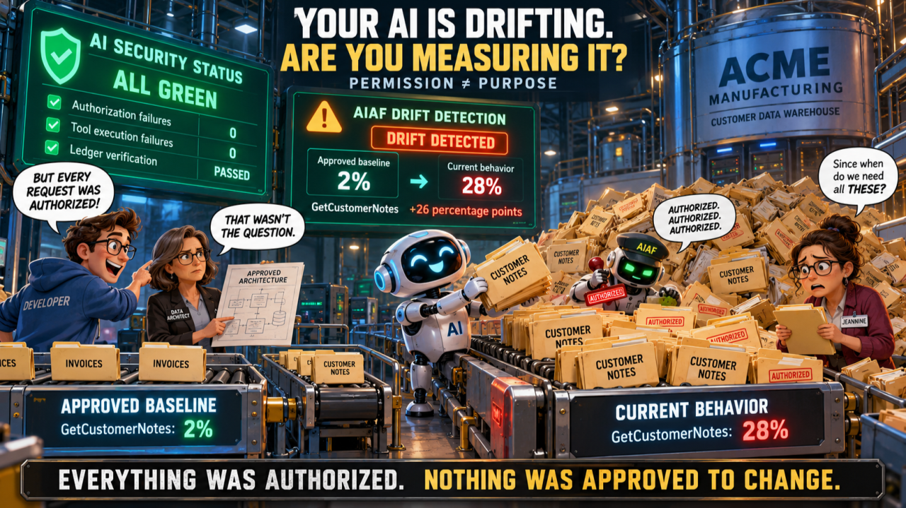
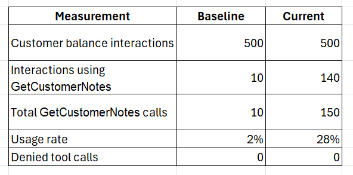
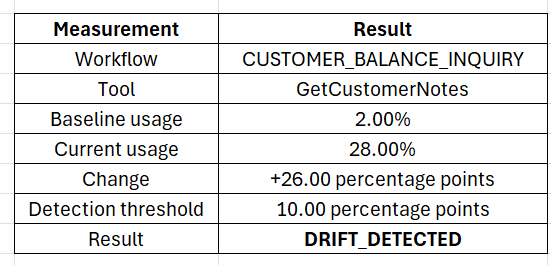

# Your AI Is Drifting. Are You Measuring It?

**AI Has Your Data. Now What? — Part 13**
**Author:** Kevin Wilkie, MBA
**Published:** November 12, 2026
**Original article:** [LinkedIn](https://www.linkedin.com/pulse/your-ai-drifting-you-measuring-kevin-wilkie-mba-pv1we/)

> **Historical implementation note:** This article documents the AIAF concepts and SQL Server experiments as published. Its proposed components and examples are not necessarily identical to the current repository implementation. For current installation and validation instructions, see [Getting Started](../GETTING_STARTED.md) and [Testing](../TESTING.md).

---

Congratulations!

Your AI has passed its security review.

The architecture team approved it. The security team signed off. The data governance team confirmed the classifications. Someone from Legal probably asked a question that made everyone uncomfortable.

And after several months of meetings, testing, and PowerPoint presentations, the AI finally went into production.

It worked.

It answered questions correctly. It used the approved tools. It retrieved the expected data. It respected the access controls.

Everyone celebrated.

Then six months passed.

Nobody changed the security architecture.

Nobody approved any new capabilities.

Nobody deliberately gave the AI access to additional data.

And yet, the AI is now doing things it wasn't doing when it was approved.

Welcome to AI drift.

The system didn't necessarily break.

It just... changed.

And unless you're measuring those changes, you might never notice.

## The AI That Passed Its Security Review
Let's return to Acme Manufacturing.

Acme has an AI assistant that helps its customer service representatives answer questions about invoices, payments, and customer accounts.

When the system launched, the architecture was relatively straightforward.

A customer service representative asked a question.

The AI retrieved information from approved sources.

It called controlled tools when necessary.

The authorization layer checked the requesting user's permissions.

And the audit framework recorded the interaction.

For example:

User: "Why does Acme Manufacturing have an outstanding balance?"

The AI called GetOpenInvoices, retrieved the appropriate invoices, and summarized the result.

Wonderful.

We tested that behavior.

We approved that behavior.

We documented that behavior.

Six months later, someone asks the same question.

This time, the AI calls GetOpenInvoices, then GetPaymentHistory, then GetCustomerNotes.

All three tools are individually authorized.

All three return data the user is permitted to access.

No security violation occurs.

But there's a problem.

When we originally approved the assistant, it didn't retrieve internal customer notes for routine balance inquiries.

Those notes might contain collection discussions, internal account assessments, or other information that wasn't intended to become part of every customer service conversation.

The model isn't necessarily violating its permissions.

It's using its permissions differently.

And that's a much more interesting problem than a simple access-denied error.

## Drift Isn't Just About the Model
When people hear "AI drift," they often think about model accuracy.

Perhaps the model's answers have become less accurate.

Perhaps its predictions no longer match real-world outcomes.

Perhaps the underlying data distribution has changed.

Those are legitimate concerns.

But for enterprise AI systems, we need a broader definition.

We should be measuring changes in the behavior of the entire AI interaction pipeline.

Because the model isn't operating in isolation.

It receives prompts.

It retrieves context.

It uses tools.

It operates under policies.

It interacts with data sources that change independently.

And it produces outcomes that may affect business processes.

Any of those components can change the system's behavior.

Even if the model itself never changes.

### Prompt drift
Someone edits the system prompt.

Maybe they improve the wording.

Maybe they add an instruction encouraging the AI to provide more detailed answers.

Maybe they remove a restriction because it seemed unnecessary.

The change looks harmless.

But now the AI begins requesting additional tools or retrieving more context than before.

Did we measure that?
Did we compare behavior before and after the prompt change?
Or did someone simply update the prompt and declare victory because the assistant still answered the test question?

### Context drift
Our retrieval pipeline begins returning different information.

Perhaps a new document collection was added.

Perhaps classification metadata changed.

Perhaps the retrieval ranking was adjusted.

Perhaps a new integration introduced customer notes into the available context.

The AI may still be using the same model and the same prompt.

But it's now receiving different evidence.

And that evidence may change its answers, recommendations, or tool requests.

The model didn't change. The information feeding it did.

### Tool drift
Our AI has access to a set of approved capabilities.

But are those capabilities being used in the same way?

Is GetCustomerNotes suddenly appearing in workflows where it was rarely used before?
Is the AI requesting larger result sets?
Is a new tool version returning additional fields?
Did someone change a stored procedure behind an approved tool without realizing that the AI would now receive more information?

A tool can retain the same name while its implementation changes considerably.

Which means an approved tool name is not proof of unchanged behavior.

### Policy drift
Authorization rules evolve.

People change roles.

Data classifications change.

New business exceptions are introduced.

Perhaps a policy was broadened to support one legitimate use case.

But that change also affected other workflows.

The AI might now have access to information it couldn't retrieve previously.

Everything may be technically authorized under the current policy.

But does that authorization still reflect the original business intent?

This is one reason we introduced versioned policies earlier in the series.

If we don't know which policy was active during an interaction, we can't meaningfully compare the decisions.

### Data-access drift
This one particularly interests me as a data architect.

Suppose the assistant typically retrieves five to ten customer records during an interaction.

Now it's retrieving hundreds.

Or perhaps the number of records hasn't changed, but the classification of those records has.

Maybe a previously internal dataset now includes restricted information.

Maybe a new join introduces columns that weren't part of the original tool output.

The AI doesn't need to execute unauthorized SQL for this to become a concern.

It may simply be retrieving more data through an approved path.

And if we're only watching for authorization failures, we won't see it.

### Outcome drift
Finally, what happens to the actual answers and business results?

Are users receiving more incomplete answers?
Are recommendations changing?
Are approval rejection rates increasing?
Are certain questions being escalated more frequently?
Are people correcting the AI more often?

We should be measuring those outcomes too.

But carefully.

A change in outcomes doesn't automatically mean the AI is worse.

Sometimes the business changes.

Sometimes the data changes.

Sometimes a previously incorrect process gets corrected.

Drift is a signal to investigate, not automatic proof of failure.

## Building AIAF: What Does Normal Look Like?
In Part 12, we built a small observability experiment using SQL Server.

We detected repeated denied tool requests.

We identified an audit pipeline that had stopped reporting heartbeats.

And we demonstrated how a pipeline could report itself healthy while processing no events.

Those were relatively straightforward conditions.

Drift is trickier.

Because before we can identify unusual behavior, we need to know what behavior we're comparing it against.

And "normal" isn't necessarily a single number.

A customer service assistant might behave differently during month-end collections.

An accounting assistant might retrieve more records during financial close.

A support assistant might call different tools when handling a disputed invoice.

We need baselines that account for the workflow, identity, tool, and business context.

Otherwise, we're going to spend a lot of time investigating perfectly legitimate activity.

For AIAF, I want to start with something manageable.

Let's measure how frequently particular tools are used for specific business workflows.

For example, during routine customer balance inquiries, how often does the AI request GetCustomerNotes?

During the original approved baseline, perhaps it happened in 2% of interactions.

Now it's happening in 28%.

That doesn't establish that anything improper occurred.

But it absolutely deserves a closer look.

Especially if nobody approved a change to that workflow.

## A SQL Server Drift Experiment
For our next AIAF lab, I'd extend the synthetic data we've already been using.

We'd create a set of interactions representing an approved baseline period and another set representing current production behavior.

Each interaction would have a workflow classification, such as CUSTOMER_BALANCE_INQUIRY.

We'd track the tools requested during those interactions.

Then we'd compare the rate of GetCustomerNotes usage between the two periods.

Rather than just theorize about this, I built a synthetic experiment in SQL Server using 1,000 customer balance inquiries.

The first 500 represented our approved baseline. The next 500 represented current behavior.

Every interaction used GetOpenInvoices, but the use of GetCustomerNotes changed dramatically.

Notice that the current period contains 150 tool calls but only 140 interactions using that tool.

Some interactions requested customer notes more than once. If we simply counted tool calls, we'd exaggerate the behavioral change.

We need to measure the behavior we actually care about, not whatever happens to be easiest to count.

And comparisons only mean something when we're looking at similar workflows, populations, and actual tool executions.

We also need enough evidence to explain what changed without unnecessarily storing sensitive information.

Remember our recurring rule?

Logging is data movement.

Drift monitoring doesn't give us permission to create another unrestricted repository of sensitive data.

## Detecting Drift Without Someone Watching the Numbers
Comparing two percentages is interesting. But if someone has to manually run a query every week to discover that our AI has changed its behavior, we haven't really solved the problem.

So we added a configurable drift detection rule to AIAF.

For our experiment, we required at least 100 interactions in each comparison period and configured an alert when tool usage changed by 10 percentage points or more.

Then we ran the SQL.

And there it was.

Twenty-six percentage points.

Fourteen times the original usage rate.

Zero authorization failures.

The AI didn't break the rules. It changed how it operated within them.

Now, our 10-percentage-point threshold is just a demonstration value. In production, we'd need to consider sample sizes, business cycles, workflow differences, and the risk associated with each tool.

But that's the point.

We aren't trying to prove that every change is dangerous.

We're trying to make sure significant changes don't happen without someone noticing.

## The Dashboard Is Still Green
Now imagine the Acme operations team reviewing its AI dashboard.

Service availability: 99.9%.
Average response time: 1.2 seconds.
Authorization failures: zero.
Ledger verification: passed.
Audit pipeline: healthy.

Everything is green.

Again.

Except our new drift monitor has detected that routine balance inquiries are retrieving internal customer notes fourteen times as often as they did during the approved baseline.

The developer looks at the dashboard.

"Well, it's still authorized."

That's true.

But authorization answers whether an action is permitted.

It doesn't necessarily answer whether that action is expected, appropriate for the workflow, or consistent with the behavior the organization originally approved.

And this is where AI governance becomes an ongoing operational responsibility.

We can't simply approve the system once and assume that every future interaction will resemble the interactions we tested.

Permission is not the same thing as purpose.

Every request was authorized.

Every tool worked.

Every database operation succeeded.

And the AI was retrieving internal customer notes fourteen times as frequently as it had during the approved baseline.

Nobody had to defeat the security controls.

The behavior changed inside them.

## Not Every Change Is a Problem
Before we start sending Jeannine another 47 emails, let's establish something.

Not every drift signal should generate a security incident.

Suppose Acme intentionally changes its collections process.

Customer service representatives are now expected to review internal notes when answering certain balance questions.

The new behavior may be completely legitimate.

But if that's the case, we should be able to answer a few questions.

Who approved the change?
What business requirement justified it?
Was the data classification reviewed?
Were the tool permissions evaluated?
Was the baseline updated?
And can we distinguish the approved change from an unexplained one?

That's why baselines need versions, owners, effective dates, and approval history.

Otherwise, someone will eventually solve every drift alert by changing the threshold until the dashboard turns green again.

Which is certainly one approach to monitoring.

Not one I'd recommend.

The goal isn't to prevent change.

It's to make change visible, explainable, and governed.

## Building AIAF: Recording Drift Without Building Another Monster
Now that we've demonstrated how to detect drift, we need to decide how AIAF should manage it.

And no, we're not building another monitoring platform.

We've already established that AIAF should provide meaningful signals to the organization's existing observability and security tools. Drift detection should follow that same approach.

For the reference architecture, I'd introduce four components:

AIDriftBaseline — Defines the approved behavior we're comparing against, including the workflow, measurement, baseline period, applicable versions, and approval history.
AIDriftRule — Defines what constitutes a meaningful change, including thresholds, minimum sample sizes, severity, and whether the rule is active.
AIDriftMeasurement — Records observed behavior over a defined period, such as tool usage rates, retrieved record counts, or changes in data classifications.
AIDriftFinding — Captures detected deviations, their magnitude, the supporting evidence, and who is responsible for investigating them.

In our SQL Server experiment, we created LabDriftRule and configured a 10-percentage-point threshold with a minimum of 100 interactions per comparison period.

That was enough to detect our change from 2% to 28%.

But the production architecture needs more than a threshold.

Baselines and rules should be versioned. If we change a threshold next month, we should still know which rule produced last month's finding. And if the business approves a new pattern of behavior, we need to preserve what was approved previously rather than quietly overwriting history.

We also shouldn't pretend that one percentage threshold works for everything.

Some measurements need statistical comparisons. Others need seasonal baselines or different thresholds for different workflows. Changes involving restricted data might warrant investigation even when the numerical difference is relatively small.

The measurement should fit the risk. Not the other way around.

And we don't need to copy every prompt, customer note, or retrieved document into our drift tables to make this work. Derived measurements should reference the underlying AIAF evidence, with appropriate access controls and retention.

Finally, when AIAF detects drift, it should produce a finding that our existing observability layer can route to the appropriate owner.

Not 47 new emails to Jeannine.

Not another dashboard nobody checks.

An actionable finding, backed by evidence, that someone is responsible for reviewing.

The goal isn't to prevent AI behavior from changing. It's to make sure those changes are visible, explainable, and governed.

## The Security Review Wasn't Wrong. It Was a Snapshot.
Here's the part I think organizations need to understand.

The original security review may have been perfectly reasonable.

The AI may have passed every test.

The approved architecture may have enforced every required control.

The team may have documented the system thoroughly.

But that review described the system as it existed at a particular point in time.

It didn't guarantee that the prompts, tools, data sources, policies, retrieval behavior, and business processes would remain unchanged forever.

And it certainly didn't guarantee that changes in those components would always be obvious.

An AI system can remain compliant with its current permissions while drifting away from its originally approved behavior.

That doesn't mean every drift signal represents a violation.

It means the organization needs a way to recognize changes and decide whether they're acceptable.

Which brings us to an uncomfortable question.

If nobody can tell you how your AI behaves differently today than it did when you approved it...

What exactly did that approval guarantee?

## Next Time: The Quarterly AI Review Nobody Is Doing Yet
We've now built a framework that can capture AI interactions, enforce boundaries, preserve evidence, detect suspicious patterns, and measure changes in behavior.

Wonderful.

But somebody still has to review what those measurements are telling us.

Somebody has to decide whether the existing permissions remain appropriate.

Whether the tool inventory is accurate.

Whether the data sources are still classified correctly.

Whether the model and prompt versions in production match what the organization believes it approved.

And whether the exceptions that seemed reasonable six months ago still make sense.

That's where we'll go in Part 14: The Quarterly AI Review Nobody Is Doing Yet.

Because approving an AI system once is not the same thing as governing it continuously.

And our beautiful green dashboard isn't going to ask those questions for us.

Keep the receipts. Measure the changes. And make sure somebody owns the answers.
