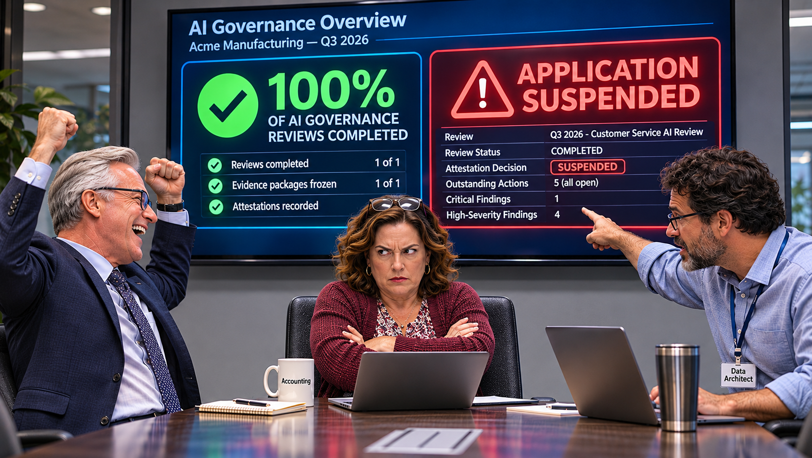
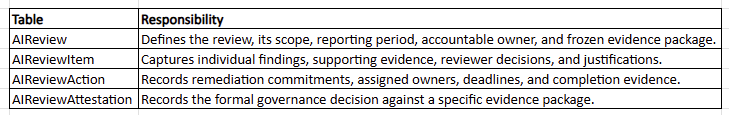
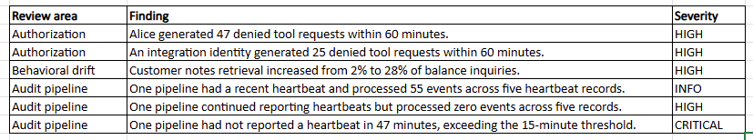
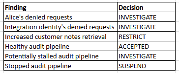
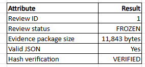
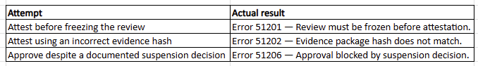
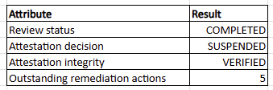
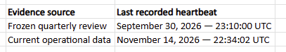
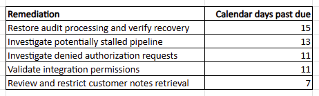
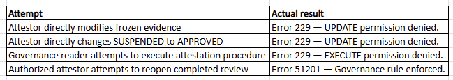

# The Quarterly AI Review Nobody Is Doing Yet

**AI Has Your Data. Now What? — Part 14**
**Author:** Kevin Wilkie, MBA
**Published:** November 19, 2026
**Original article:** [LinkedIn](https://www.linkedin.com/pulse/ai-has-your-data-now-what-kevin-wilkie-mba-wksre/)



> **Historical implementation note:** This article preserves the published SQL Server governance demonstration, including its synthetic operational evidence and stated limitations. It is not a deployment guide for the current AIAF repository. See [Getting Started](../GETTING_STARTED.md), [Testing](../TESTING.md), and [Production Readiness](../PRODUCTION_READINESS.md).

---

Six months ago, your company deployed its first enterprise AI application.

Security reviewed it. Architecture approved it. Legal had a few questions. Data Governance attended several meetings. Someone created a rather impressive PowerPoint presentation.

Everybody agreed that the application was ready for production.

Six months later, that approval document is still sitting in SharePoint.

Meanwhile:

The development team has modified the system prompt.
Additional data sources have been introduced.
A stored procedure used by one of the AI's tools has been rewritten.
The underlying language model has been upgraded.
Several users have changed roles.
A temporary security exception has become considerably less temporary.
Nobody has revisited the original approval.

But the application is working.

The executives are happy.

The developers are working on the next AI initiative.

And nobody has asked what might be the most important question:

Would we still approve this application today?

The approval didn't expire.

The assumptions behind it did.

## We Already Know How to Do This
Enterprise IT isn't exactly unfamiliar with periodic reviews.

We review privileged accounts. We recertify access to sensitive systems. We conduct disaster recovery exercises. We evaluate third-party vendors. We review security exceptions.

Depending on the organization, we might even occasionally test whether those database backups we've been taking for years can actually be restored.

Revolutionary stuff.

Yet many organizations are treating AI approval as a one-time event.

That might be understandable if AI applications remained static after deployment.

They don't.

An enterprise AI application is a collection of interconnected components, each capable of changing independently:

Models and model configurations
System prompts and prompt templates
Retrieval mechanisms
Data sources and business definitions
Tools and execution capabilities
Security policies
User identities and permissions
Monitoring and auditing infrastructure

Any one of those changes can affect the application's risk profile without producing a single application error.

The original approval might have been entirely appropriate.

That doesn't mean it still is.

## Welcome Back to Acme Manufacturing
Throughout this series, we've been building an AI-powered customer service assistant for our fictional friends at Acme Manufacturing.

We've given it controlled access to customer information. We've restricted its tools. We've established authorization rules, captured audit evidence, introduced observability, and measured behavioral drift.

Now it's time for Acme's third-quarter AI governance review.

The development team arrives with good news.

The application is operational. Customers are receiving answers. The business hasn't reported any significant problems.

Someone has even prepared a dashboard.

Naturally, there's a great deal of green on it.

Jeannine from Accounting has been invited to the meeting, although she's still trying to determine whether she's supposed to approve something or simply provide financial information.

The data architect arrives with a slightly different set of numbers.

Things are about to get interesting.

## What Should an AI Governance Review Actually Review?
A quarterly AI review shouldn't consist of asking the development team whether anything significant has changed.

It should be an evidence-driven reassessment of the application, its behavior, its controls, and the assumptions under which it was originally approved.

At a minimum, I would want to examine six areas.

### 1. Application Configuration and Inventory
What was originally approved, and what is actually running today?

Which model is being used? Which prompt versions are active? What data sources can the application retrieve from? Which tools are available?

Have new capabilities been introduced since the last review?

Can we identify who authorized those changes?

A deployment history might tell us that something changed.

It doesn't necessarily tell us whether the change was appropriate.

### 2. Effective Permissions and Capabilities
What can the AI application actually do today?

Not what the architecture diagram says it can do.

Not what the original security review says it can do.

What it can actually do.

Service accounts accumulate permissions. Stored procedures acquire additional functionality. Tool definitions change. Users move between departments. Temporary exceptions become permanent through organizational archaeology.

We need to evaluate the effective capabilities of the application against its approved business purpose.

As we discussed earlier in this series:

Capability is not authority.

### 3. Behavioral Drift
Is the application behaving differently than it did when we approved it?

Perhaps it retrieves additional customer information. Perhaps it invokes certain tools more frequently. Perhaps it has started accessing data that was originally considered unnecessary for its intended workflow.

Not every behavioral change represents a security incident.

Some changes are desirable.

But someone should be able to explain them, evaluate their consequences, and determine whether a new behavioral baseline is appropriate.

Permission is not the same thing as purpose.

### 4. Security Control Effectiveness
Are our security controls still functioning?

How frequently are requests being denied? Are particular identities repeatedly attempting unauthorized operations? Have our validation mechanisms been tested against newly introduced functionality?

A large number of denied requests might indicate that our controls are working.

It might also indicate that someone is spending an extraordinary amount of time trying to get around them.

Those are two very different conversations.

### 5. Evidence Integrity and Completeness
Can we trust the information we're using to conduct the review?

Are audit pipelines functioning? Are interactions being captured? Are independently protected ledger digests current and successfully verified, where those controls have been implemented?

Can we establish whether evidence is missing?

A successful integrity check doesn't necessarily establish completeness.

A healthy heartbeat doesn't necessarily establish that every expected event was processed.

And an empty audit table might mean that nothing happened.

Or it might mean that nothing was recorded.

I'd prefer to know which before approving another quarter of AI operations.

### 6. Exceptions and Outstanding Remediation
Which risks were previously accepted?

Which exceptions are still active?

Who owns them? When do they expire? What corrective actions were promised?

And perhaps most importantly:

Did anybody actually complete those actions?

A security exception without an expiration date is often just a security policy wearing a different name.

## Building AIAF: The Governance Review
Throughout this series, we've been developing the AI Interaction Audit Framework (AIAF), a provider-neutral reference architecture for capturing evidence and establishing controls around enterprise AI interactions.

For this installment, I wanted to take the evidence we've collected in previous articles and turn it into something an organization could use during a formal governance review.

I implemented a simplified SQL Server reference model using four additional tables.


These structures are deliberately separate.

A finding is not a decision.

A decision is not a remediation action.

A remediation action is not proof that the underlying problem has been resolved.

And completing a review is not the same as approving the application.

For our demonstration, I populated the operational tables with synthetic evidence representing the authorization, drift, and observability scenarios we've explored throughout this series.

The SQL Server testing, constraints, stored procedures, permission checks, and resulting errors, however, are real.

## Acme's Quarterly Review Results
Rather than asking someone to manually assemble a spreadsheet, I generated review findings directly from the operational evidence.

Here's what our governance review discovered.


Six review items.

One critical finding.

Four high-severity findings.

One informational finding.

This doesn't mean Acme experienced a confirmed security breach. Repeated denials require investigation. Behavioral drift requires explanation. A pipeline processing zero events could simply be idle.

But these findings represent questions that need to be answered.

And that critical audit pipeline finding presents a particularly uncomfortable question:

Can we establish what the AI was doing during the period when our auditing infrastructure wasn't reporting as expected?

Suddenly, that green dashboard isn't quite as reassuring.

Don't Just Store the Finding. Store the Evidence.
One of the problems with traditional governance documentation is that conclusions often outlive the evidence supporting them.

Someone writes, "Excessive denied authorization requests were identified."

Great.

How many requests?

Across what period?

From which identity?

Based on what threshold?

Which records supported that conclusion?

Can we reconstruct the evaluation six months later?

For our AIAF implementation, each finding contains a structured JSON evidence snapshot.

Here's an excerpt from the actual behavioral drift finding:

```json
{
  "WorkflowCode": "CUSTOMER_BALANCE_INQUIRY",
  "ToolCode": "GetCustomerNotes",
  "BaselineInteractions": 500,
  "CurrentInteractions": 500,
  "BaselineToolInteractions": 10,
  "CurrentToolInteractions": 140,
  "BaselinePercent": 2.00,
  "CurrentPercent": 28.00,
  "PercentagePointChange": 26.00,
  "MinimumBaselineInteractions": 100,
  "MinimumCurrentInteractions": 100,
  "MinimumPercentagePointChange": 10.00,
  "EvaluationResult": "DRIFT_DETECTED"
}
```
We're not simply recording that drift occurred.

We're recording the measurements, sample sizes, evaluation criteria, and resulting conclusion.

For the authorization findings, we also retained the supporting tool-call identifiers and timestamps.

For the audit pipeline findings, we retained the individual heartbeat records used during the evaluation.

All six evidence snapshots occupied approximately 6.5 KiB.

We didn't need to duplicate customer notes, raw prompts, or sensitive business records.

We needed enough evidence to explain and support the finding.

Remember our discussion from earlier in this series:

Logging is data movement.

Governance evidence deserves the same attention to data minimization as the operational audit records themselves.

## Somebody Has to Make a Decision
Generating findings is relatively straightforward.

Getting somebody to take responsibility for them is where things become considerably more interesting.

For Acme's quarterly review, I recorded the following illustrative reviewer decisions:


Each decision includes a reviewer identity, a timestamp, and a documented justification.

Five findings also generated remediation actions with assigned owners and deadlines.

I wanted to make sure that our architecture enforced these requirements rather than simply recommending them.

So I deliberately attempted to record a review decision without identifying a reviewer or providing a reason.

SQL Server responded:

```text
Msg 547

The UPDATE statement conflicted with the CHECK
constraint "CK_AIReviewItem_DecisionMetadata".
```
Good.

Next, I attempted to mark the critical remediation action as completed without providing completion evidence.

SQL Server responded:

```text
Msg 547

The UPDATE statement conflicted with the CHECK
constraint "CK_AIReviewAction_Completion".
```
Even better.

Does requiring completion evidence guarantee that the evidence is accurate or sufficient?

Of course not.

But we've established a minimum requirement that cannot be bypassed simply because someone forgot to validate a field in the application.

Or because somebody really wanted that red item off their dashboard.

## Freeze the Evidence
Once the reviewers have completed their assessments and assigned the necessary remediation actions, we have a new problem.

The underlying operational data is going to continue changing.

New interactions will be captured. New tool calls will be recorded. Pipelines will recover. Problems may be resolved. Additional problems may be discovered.

If someone revisits the quarterly review six months later, they should be able to determine what information was considered when the original decision was made.

Not what the information looks like today.

To support that requirement, I created a stored procedure:

```sql
EXEC aiaf_governance.usp_FreezeReview @ReviewId = 1;
```
The procedure validates that the review contains findings, that reviewer decisions have been recorded, and that necessary remediation commitments exist.

It then creates a structured evidence package containing:

Review and application metadata
Findings and supporting evidence
Reviewer identities and decisions
Decision justifications
Remediation commitments and deadlines
Remediation statuses at the time of freezing

Finally, it calculates a SHA-256 fingerprint of the serialized UTF-8 evidence package.

Here's what the actual execution returned:


The resulting SHA-256 fingerprint was:

`C6FE49F9FCC9E422809A5847EA2B709207367F19DF5FC473FD94215E188DA573`
Less than 12 KB for the entire frozen governance review, including its supporting evidence.

The hash allows us to identify the exact package associated with an attestation and detect a mismatch if that package changes.

However, as we discussed in Part 11, a hash stored alongside the data is not independently protected tamper evidence. Someone with sufficient privileges could change the package and recalculate its hash.

A production implementation should protect that fingerprint through an independently controlled mechanism, potentially incorporating the ledger capabilities we explored earlier in this series.

The important architectural distinction is that the review now refers to a specific evidence package rather than a collection of constantly changing operational records.

## Now Comes the Fun Part
Our quarterly review contains six findings.

All six have reviewer decisions.

All five necessary remediation actions have owners and deadlines.

The evidence package has been frozen and its hash verified.

The application owner is ready to approve the quarterly review.

Everything is documented.

Everything is accounted for.

Except for one rather inconvenient detail.

The review contains a suspension decision.

I created another stored procedure, usp_AttestReview, to record the formal governance decision.

The procedure requires an existing frozen evidence package, a matching SHA-256 hash, an attesting identity, and a documented reason.

It also evaluates the requested attestation against the decisions contained in that frozen package.

I then deliberately attempted three inappropriate attestations.


That third test is particularly important.

We had a valid reviewer identity.

We had a valid attestation reason.

We had the correct evidence package.

The evidence passed its integrity verification.

And the procedure still refused to approve the application.

Because the proposed approval contradicted the governance decisions contained within that evidence.

Governance isn't the ability to record an approval. It's the ability to prevent one.

## A Completed Review Is Not an Approved Review
Rather than attempting to approve the application, Acme's application owner formally recorded the appropriate outcome.

The attestation was successful.

Here are the actual results:


Read that again.

The quarterly review is completed.

Continued operation has not been approved.

Imagine an executive dashboard reporting that 100% of Acme's quarterly AI governance reviews have been completed.

Bring out the green checkmarks!

Except the review we just completed resulted in a suspension decision.

Perhaps we need another metric.

Of course, recording a suspension decision doesn't automatically shut down an AI application. A production architecture needs an enforcement mechanism capable of translating that decision into operational restrictions.

Otherwise, we've simply documented that the application shouldn't be running while allowing it to continue running.

That would be a rather expensive form of meeting minutes.

## But We Fixed It!
Shortly after Acme completes its quarterly review, Data Operations restores heartbeat activity for the affected audit pipeline.

The development team returns with good news.

The pipeline is processing events again.

We can change the quarterly approval now, right?

To demonstrate this scenario, I inserted five synthetic heartbeat records representing the recovery of the previously stopped pipeline.

I then compared the current operational evidence against the frozen review package.


The operational data had changed.

The frozen evidence had not.

I recalculated the SHA-256 fingerprint.

It still matched the original package.

I then attempted to change the governance outcome by submitting a new approval against the completed review.

The procedure rejected it.

```text
Error 51201

Review must be frozen before attestation.
```
The review had already been completed and was no longer eligible for attestation.

Restored heartbeat activity also doesn't establish that missing evidence has been recovered or that the other outstanding risks have been resolved.

Acme needs a reassessment, supported by new evidence and a new governance decision.

It doesn't need somebody rewriting the original one.

New evidence doesn't invalidate history. It informs the next decision.

A production implementation should explicitly support versioned reassessments and link them to the original review. That's an extension to the current reference implementation.

## What About the Outstanding Remediation?
Remember those five remediation actions we assigned during the review?

Completing the review didn't complete those actions.

I simulated advancing our reporting date to December 1.

Here's what our remediation report returned, assuming none of the actions had been completed.


Five overdue remediation commitments.

Named owners.

Documented deadlines.

And a completed quarterly review.

The governance meeting might be over.

The governance obligations aren't.

## We Can Just UPDATE the Table Though? Right?
At this point, the database professionals reading this article are probably asking a perfectly reasonable question.

What's preventing somebody from bypassing the stored procedure and directly updating the underlying table?

Initially, the answer was: not enough.

So, I implemented separate database roles for governance readers, reviewers, and attestors.

The appropriate roles received permission to execute their designated stored procedures. Direct insertion, modification, and deletion of governance records were denied.

Then I impersonated database users assigned to those roles and deliberately attempted to bypass the controls.


The last test illustrates the difference between access control and process control.

The attestor had permission to enter the stored procedure.

The attestor did not have permission to ignore its business rules.

We now have three complementary layers of protection:

Data integrity: Database constraints enforce required information.
Process integrity: Controlled stored procedures enforce governance rules.
Access control: Database permissions restrict who can perform those operations.

None of these is sufficient by itself.

And none requires asking a language model whether the proposed approval looks reasonable.

## What Did We Actually Accomplish?
Across this demonstration, I executed 15 validation scenarios against the SQL Server reference implementation.

All 15 produced the expected results.

We demonstrated that we could:

Generate governance findings from operational evidence.
Require documented reviewer decisions.
Assign remediation ownership and deadlines.
Freeze the evidence considered during a review.
Bind an attestation to a specific evidence package.
Prevent an approval that contradicts a suspension decision.
Preserve historical evidence as operational data changes.
Identify overdue remediation after a review has been completed.
Prevent ordinary governance users from directly rewriting protected records.

Is this a complete enterprise governance platform?

Not even close.

The current demonstration uses synthetic operational data and caller-supplied reviewer identities. It doesn't yet implement authenticated reviewer authority, independently protected evidence fingerprints, versioned reassessments, or automated runtime enforcement of suspension decisions.

Additional controlled interfaces are needed for decision and remediation management. Successful write operations through the restricted governance roles also warrant further testing.

Database administrators retain privileges that can bypass many of these protections.

Those limitations matter.

AIAF is a reference architecture, not a security product.

The purpose is to demonstrate the architectural capabilities that need to exist, regardless of which AI provider, database platform, or governance tooling an organization ultimately chooses.

## Why Quarterly?
Quarterly is a reasonable starting point for many enterprise applications.

It's not a universal requirement.

A relatively low-risk internal assistant might warrant a different review cadence than an autonomous agent capable of modifying financial records or accessing regulated information.

Organizations should establish review frequency based on risk, business impact, regulatory requirements, and the rate of change within the application.

Certain events should also trigger an immediate reassessment:

Significant model or prompt changes
Expanded data access
Introduction of new write capabilities
Material behavioral drift
Critical security incidents
Failures in auditing or monitoring infrastructure
Changes to the application's approved business purpose

If Acme discovers in August that its AI auditing infrastructure has stopped functioning, October's quarterly review is not the appropriate time to begin investigating.

Continuous monitoring and periodic governance reviews serve different purposes.

We need both.

## Back in the Conference Room
The development team is explaining that every customer note retrieval was technically authorized.

Security is investigating the repeated authorization denials.

Data Operations is working to establish whether historical audit evidence is missing.

The data architect is asking who approved the change in the application's behavior.

The application owner is reviewing the suspension recommendation.

Jeannine has finally had enough.

"So, are we approving this thing or not?"

It's a remarkably good question.

And unlike six months ago, we now have a structured body of evidence to help answer it.

We have documented findings, reviewer decisions, remediation commitments, and an accountable owner.

We can identify precisely what information supported the final decision.

We can even prevent certain inappropriate decisions from being recorded.

But somebody still has to accept responsibility for the outcome.

Technology can support governance.

It cannot manufacture accountability.

## What's Next?
Throughout this series, we've examined individual components of enterprise AI data architecture.

We've discussed prompts as data, sensitive information, validation, policy versioning, retrieval lineage, reproducibility, database access, controlled tools, write operations, audit integrity, observability, behavioral drift, and now formal governance reviews.

Each component addresses a different problem.

None of them independently makes an enterprise AI application trustworthy.

In the final installment of this series, we'll bring these components together into a cohesive reference architecture.

Part 15 — Building an AI Data Pipeline That We Can Actually Trust

Because we spent decades learning how to secure the database.

Then we connected an AI to it.

It's time our architecture caught up.

Until then:

Keep the receipts. Review the evidence. And make somebody accountable for the decision.
